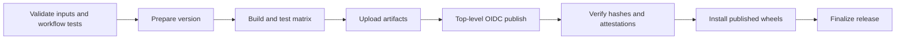

# Python package publishing

`release.yaml` builds and tests `megatron-core` on amd64 and arm64 and
`megatron-fsdp` on amd64. `_build_test_wheel.yml` produces distribution
artifacts with read-only repository access. The top-level publishing job
downloads those artifacts and authenticates with PyPI using GitHub OIDC.
Only amd64 artifacts include the source distribution for each package.

| Dispatch inputs | Behavior |
| --- | --- |
| `dry-run: true` | Build rehearsal artifacts; do not upload distributions. |
| `dry-run: false`, `publish-target: testpypi` | Upload development versions to TestPyPI; validate release preparation/finalization without writing branches, tags, releases, documentation, or release announcements. |
| `dry-run: false`, `publish-target: pypi` | Publish the requested release commit to production, verify the upload, then finalize the release. Run this workflow from `main`. |

Supply a full 40-character commit SHA as `release-ref`. TestPyPI and dry-run
builds append a run/attempt development suffix consistently across the matrix.
The verification jobs require the complete expected file set, matching SHA-256
hashes, and signed provenance from this repository's `release.yaml`. They then
install the published wheel on each supported architecture and check its version.
Dependencies are installed from production PyPI; TestPyPI installations use
`--no-deps` and an exact version.

## Publisher setup

An owner must register a GitHub trusted publisher for **both** projects on each
index before uploads to that index will work:

| Field | Production PyPI | TestPyPI |
| --- | --- | --- |
| Owner | `NVIDIA` | `NVIDIA` |
| Repository | `Megatron-LM` | `Megatron-LM` |
| Workflow filename | `release.yaml` | `release.yaml` |
| Environment | `pypi` | `testpypi` |

Restrict the production `pypi` GitHub environment to `main`. Permit only the
intended rehearsal branch in `testpypi` while testing unmerged changes. The
TestPyPI job uses `https://test.pypi.org/legacy/`; it does not fall back to
production or token authentication. Revoke the former publishing token after
a verified production release.



Local regression checks:

```bash
python -m pytest .github/scripts/test_release_workflow.py
actionlint -shellcheck='' -pyflakes='' .github/workflows/release.yaml .github/workflows/_build_test_wheel.yml
```

TestPyPI validates the upload path independently of production. Its publisher
registrations do not validate production PyPI's configuration.
