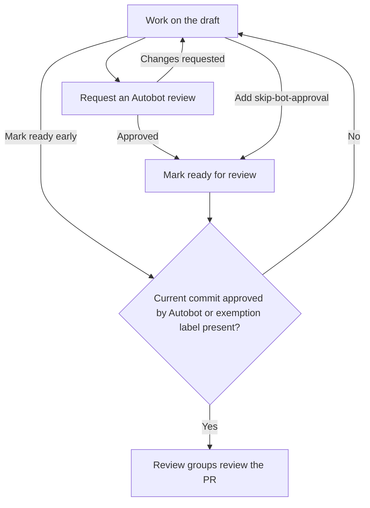

<!-- megatron-lm-draft-review -->
Keep this PR in draft while you work. Request an Autobot review in a PR comment and address any findings.

- `/review-approve` requests a findings-only follow-up.
- `/review-approve reset=true` requests a full review.

Once Autobot approves the latest commit, click **Ready for review**. To use the exemption, add the `skip-bot-approval` label before clicking **Ready for review**. If your fork needs a CI mirror, ask a maintainer to run `/ok to test` for your latest commit first.

[Megatron-LM contribution guide](https://github.com/NVIDIA/Megatron-LM/blob/main/docs/developer/submit.md)
