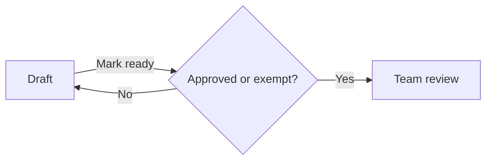

<!-- megatron-lm-draft-review -->
Request Autobot approval on the latest commit while in draft.

- `/review-approve` — findings-only
- `/review-approve reset=true` — full review

If you’re outside `mcore-engineers`, ask a member to post the command. To skip approval, add `skip-bot-approval`.

