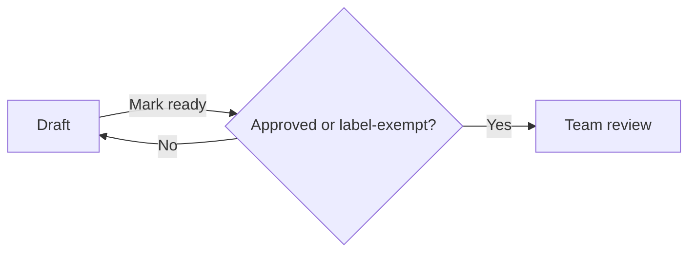

<!-- megatron-lm-draft-review -->
👉 Keep your PR in draft while you work with Autobot. Request a review in a PR comment, address any findings, and request another review after you push fixes. Once Autobot approves your latest commit, mark the PR **Ready for review** so the review groups for your changes can take over.

- `/review-approve` requests a findings-only review.
- `/review-approve reset=true` requests a full review.

If you’re outside `mcore-engineers`, ask a member to post the command for you. To proceed without Autobot approval, add `skip-bot-approval` before marking the PR ready. If you mark it ready without approval or the label, automation will return it to draft.

