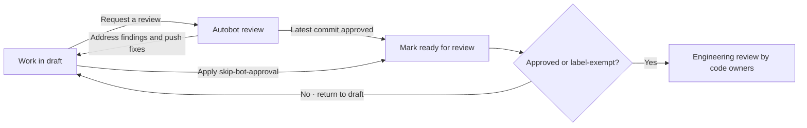

<!-- megatron-lm-draft-review -->
👉 Please work with Autobot to get your draft PR approved before asking the engineering team for a review. Comment `/review-approve` for a findings-only review or `/review-approve reset=true` for a full review. If you’re outside `mcore-engineers`, ask a member to post the command for you.

Address any findings in draft. After you push fixes, ask Autobot to take another look. Once it approves your latest commit, click **Ready for review**. GitHub will request reviews from the teams that own the files you changed.

To go straight to engineering review, add `skip-bot-approval` first. If you mark the PR ready without approval or the label, automation will move it back to draft.

