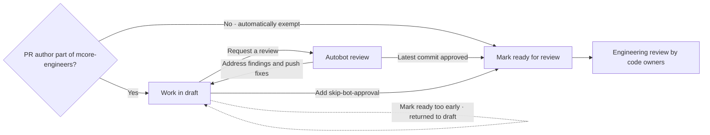

<!-- megatron-lm-draft-review -->
👉 If you’re in `mcore-engineers`, please work with Autobot to get your draft PR approved before asking the engineering team for a review. Comment `/review-approve` for a findings-only review or `/review-approve reset=true` for a full review.

Address any findings in draft. After you push fixes, ask Autobot to take another look. Once it approves your latest commit, click **Ready for review**. GitHub will request reviews from the teams that own the files you changed. Team members can also skip Autobot approval by adding `skip-bot-approval` first. If a member marks their PR ready without either approval or the label, automation will move it back to draft.

If you’re outside `mcore-engineers`, your PR is automatically exempt. Click **Ready for review** when you want engineering feedback.

