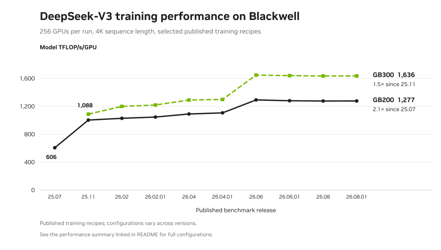

<div align="center">

Megatron-LM and Megatron Core
=============================

<h4>GPU-optimized library for training transformer models at scale</h4>

[](https://docs.nvidia.com/megatron-core/developer-guide/latest/index.html)
[](https://github.com/NVIDIA/Megatron-LM/releases)
[](./LICENSE)

<div align="left">

## About

This repository contains two components: **Megatron-LM** and **Megatron Core**.

**Megatron-LM** is a reference example that includes Megatron Core plus pre-configured training scripts, ideal for research teams, learning distributed training, and quick experimentation.

**Megatron Core** is a composable library with GPU-optimized building blocks for custom training frameworks. It provides transformer building blocks, advanced parallelism strategies (TP, PP, DP, EP, and CP), mixed precision support (FP16, BF16, FP8, and FP4), and model architectures, ideal for framework developers and ML engineers building custom training pipelines.

**[Megatron Bridge](https://github.com/NVIDIA-NeMo/Megatron-Bridge)** provides bidirectional Hugging Face ↔ Megatron checkpoint conversion with production-ready recipes.

## Getting Started

**Compatibility:** Python **3.12+** and PyTorch **2.6.0+** recommended. For source development, the tested NGC PyTorch base images are pinned in [docker/.ngc_version.dev](https://github.com/sbhavani/Megatron-LM/blob/codex/readme-refresh/docker/.ngc_version.dev) and [docker/.ngc_version.lts](https://github.com/sbhavani/Megatron-LM/blob/codex/readme-refresh/docker/.ngc_version.lts).

**Install from PyPI:**

```bash
uv pip install megatron-core
```

**Or clone and install from source:**

```bash
git clone https://github.com/NVIDIA/Megatron-LM.git
cd Megatron-LM
uv pip install -e .
```

> **Note:** Building from source can use a lot of memory. If the build runs out of memory, limit parallel compilation jobs by setting `MAX_JOBS` (for example, `MAX_JOBS=4 uv pip install -e .`).

For NVIDIA GPU Cloud (NGC) container setup and all installation options, review the **[Installation Guide](https://docs.nvidia.com/megatron-core/developer-guide/latest/get-started/install.html)**.

- **[Your First Training Run](https://docs.nvidia.com/megatron-core/developer-guide/latest/get-started/quickstart.html)** - End-to-end training examples with data preparation
- **[Parallelism Strategies](https://docs.nvidia.com/megatron-core/developer-guide/latest/user-guide/parallelism-guide.html)** - Scale training across GPUs with TP, PP, DP, EP, and CP
- **[Contribution Guide](https://docs.nvidia.com/megatron-core/developer-guide/latest/developer/contribute.html)** - How to contribute to Megatron Core
- **[Style Guide](style-guide.md)** - Python style overrides

# Latest News

- **[2026/10]** **[Scale Bitwise-Deterministic Pretraining with NVIDIA Megatron Core](https://developer.nvidia.com/blog/scale-bitwise-deterministic-pretraining-with-nvidia-megatron-core/)** - A guide to reproducing training runs, validating checkpoint resume, and reducing determinism overhead at scale with Megatron Core.
- **[2026/08]** **[Megatron Core 0.19](https://github.com/NVIDIA/Megatron-LM/releases/tag/core_v0.19.0)** - Introduces HybridModel, quantile-based MoE router balancing, packed-sequence MoE dispatch, and CUDA Graph-compatible activation offloading.
- **[2026/07]** **[DeepSeek-V3 pretraining on GB300 NVL72](https://developer.nvidia.com/blog/setting-a-world-record-for-moe-pre-training-on-nvidia-gb300-nvl72/)** - Megatron Core achieves 1,648 TFLOPs/s per GPU for DeepSeek-V3 671B on 256 GPUs.
- **[2026/05]** **[DeepSeek-V4 initial support](https://github.com/NVIDIA/Megatron-LM/issues/4468)** - Megatron Core's `dev` branch includes the initial DeepSeek-V4 implementation; Megatron Bridge provides [conversion, inference, and pretraining recipes](https://github.com/NVIDIA-NeMo/Megatron-Bridge/tree/main/examples/models/deepseek_v4).
- **[2026/04]** **[Advancing Emerging Optimizers for Accelerated LLM Training with NVIDIA Megatron](https://developer.nvidia.com/blog/advancing-emerging-optimizers-for-accelerated-llm-training-with-nvidia-megatron/)** - Muon and other emerging optimizers are now supported in Megatron Core via the new **[Emerging-Optimizers](https://github.com/NVIDIA-NeMo/Emerging-Optimizers)** library.

[Previous News](docs/discussions/README.md#previous-news)

# Project Structure

```
Megatron-LM/
├── megatron/
│   ├── core/                    # Megatron Core (kernels, parallelism, building blocks)
│   │   ├── models/              # Transformer, hybrid, and multimodal models
│   │   ├── transformer/         # Transformer building blocks
│   │   ├── tensor_parallel/     # Tensor parallelism
│   │   ├── pipeline_parallel/   # Pipeline parallelism
│   │   ├── context_parallel/    # Context parallelism
│   │   ├── distributed/         # Distributed training (Megatron FSDP, DDP)
│   │   ├── dist_checkpointing/  # Distributed checkpoint saving, loading, and resharding
│   │   ├── optimizer/           # Optimizers
│   │   ├── datasets/            # Dataset loaders
│   │   ├── inference/           # Inference engines and server
│   │   └── export/              # Model export (example: TensorRT-LLM)
│   ├── training/                # Training scripts
│   └── post_training/           # Post-training (quantization, distillation, pruning, etc.)
└── examples/                    # Ready-to-use training examples
```

# Performance Benchmarking

The [NVIDIA Megatron Bridge Performance Summary](https://docs.nvidia.com/nemo/megatron-bridge/latest/performance-summary.html) publishes training throughput, system configurations, parallelism settings, and links to [performance recipes and reproduction instructions](https://github.com/NVIDIA-NeMo/Megatron-Bridge/tree/main/scripts/performance). Use the container and matching code version specified by those instructions when reproducing a result.

## DeepSeek-V3 performance on Blackwell

Keep [Megatron Core](https://github.com/NVIDIA/Megatron-LM/releases) and [Megatron Bridge](https://github.com/NVIDIA-NeMo/Megatron-Bridge/releases) up to date to capture cumulative improvements in training performance and [recipes](https://docs.nvidia.com/nemo/megatron-bridge/latest/performance-summary.html). Published DeepSeek-V3 model TFLOP/s/GPU improved **2.1× on GB200** (606 in NeMo 25.07 to 1,277 in 26.08.01) and **1.5× on GB300** (1,088 in 25.11 to 1,636 in 26.08.01).



All runs use **256 GPUs and sequence length 4,096**. These are published recipe results: 25.07 uses FP8 and global batch size 2,048; 25.11 onward uses MXFP8 and batch size 4,096. Parallelism, microbatch settings, and model options also vary. The gains reflect the evolving training stack and recipes; individual releases can show small decreases.

<details>
<summary>Benchmark data and sources</summary>

Model TFLOP/s/GPU from the [NeMo 25.07 summary](https://docs.nvidia.com/nemo-framework/user-guide/25.07/performance/performance-summary.html) and Megatron Bridge 0.7.0 [summary](https://docs.nvidia.com/nemo/megatron-bridge/0.7.0/performance-summary.html) and [archive](https://docs.nvidia.com/nemo/megatron-bridge/0.7.0/performance-summary-archive.html). Labels identify NeMo container releases; 25.11 calls MXFP8 "FP8-MX". A dash indicates no plotted result.

The 25.07 page does not specify token dropping. From 25.11 onward, benchmarks force-balance experts and drop no tokens. The 25.11 runs exclude multi-token prediction (MTP); later tables do not specify MTP. The 25.09 result uses token dropping and is omitted.

| NeMo container | DGX-GB200 | DGX-GB300 |
| --- | ---: | ---: |
| [25.07](https://docs.nvidia.com/nemo-framework/user-guide/25.07/performance/performance-summary.html#pre-training-performance) | 606 | — |
| [25.11](https://docs.nvidia.com/nemo/megatron-bridge/0.7.0/performance-summary-archive.html#id62) | 1,003 | 1,088 |
| [26.02](https://docs.nvidia.com/nemo/megatron-bridge/0.7.0/performance-summary-archive.html#id54) | 1,028 | 1,199 |
| [26.02.01](https://docs.nvidia.com/nemo/megatron-bridge/0.7.0/performance-summary-archive.html#id44) | 1,046 | 1,219 |
| [26.04](https://docs.nvidia.com/nemo/megatron-bridge/0.7.0/performance-summary-archive.html#id33) | 1,090 | 1,290 |
| [26.04.01](https://docs.nvidia.com/nemo/megatron-bridge/0.7.0/performance-summary-archive.html#id21) | 1,106 | 1,298 |
| [26.06](https://docs.nvidia.com/nemo/megatron-bridge/0.7.0/performance-summary-archive.html#id12) | 1,292 | 1,648 |
| [26.06.01](https://docs.nvidia.com/nemo/megatron-bridge/0.7.0/performance-summary-archive.html#id2) | 1,280 | 1,640 |
| [26.08](https://docs.nvidia.com/nemo/megatron-bridge/0.7.0/performance-summary-archive.html#nemo-container) | 1,276 | 1,635 |
| [26.08.01](https://docs.nvidia.com/nemo/megatron-bridge/0.7.0/performance-summary.html#nemo-container) | 1,277 | 1,636 |

</details>

## Selected training results

Selected results from the **26.08.01 NeMo container** (August 2026):

| Model | System | GPUs | Precision | Sequence length | Tokens/s/GPU | Model TFLOPs/s/GPU |
| --- | --- | ---: | --- | ---: | ---: | ---: |
| DeepSeek-V3 | DGX-GB300 | 256 | MXFP8 | 4,096 | 6,288 | 1,636 |
| DeepSeek-V3 | DGX-GB200 | 256 | MXFP8 | 4,096 | 4,912 | 1,277 |
| Qwen3-235B-A22B | DGX-GB300 | 256 | MXFP8 | 4,096 | 8,832 | 1,306 |
| Nemotron 3 Ultra | DGX-GB300 | 256 | NVFP4 | 8,192 | 3,744 | 1,348 |

See the summary for the full batch sizes and parallelism configurations. MoE benchmarks use force-balanced expert routing and do not drop tokens. These results measure performance under the published benchmark conditions; throughput depends on the model, precision, hardware, and configuration.

# Roadmaps

- **[2026 Q3 Megatron Core Roadmap](https://github.com/NVIDIA/Megatron-LM/issues/5676)**
- **[2026 Q3 MoE Roadmap](https://github.com/NVIDIA/Megatron-LM/issues/6757)** [`dev` branch first developments]
- **[2026 Q3 Megatron FSDP v2 Roadmap](https://github.com/NVIDIA/Megatron-LM/issues/6812)** [experimental]

# Resources

## Getting Help

- 📖 **[Documentation](https://docs.nvidia.com/megatron-core/developer-guide/latest/index.html)** - Official guides and API reference
- 🐛 **[Issues](https://github.com/NVIDIA/Megatron-LM/issues)** - Bug reports and feature requests

## Contributing

Contributions are welcome. Ways to contribute:

- 🐛 **Report bugs** - Help improve reliability
- 💡 **Suggest features** - Shape the future of Megatron Core
- 📝 **Improve docs** - Make Megatron Core more accessible
- 🔧 **Submit PRs** - Contribute code improvements

**→ [Contributing Guide](https://docs.nvidia.com/megatron-core/developer-guide/latest/developer/contribute.html)**

## Citation

If you use Megatron in your research or project, use the following citation:

```bibtex
@article{megatron-lm,
  title={Megatron-LM: Training Multi-Billion Parameter Language Models Using Model Parallelism},
  author={Shoeybi, Mohammad and Patwary, Mostofa and Puri, Raul and LeGresley, Patrick and Casper, Jared and Catanzaro, Bryan},
  journal={arXiv preprint arXiv:1909.08053},
  year={2019}
}
```
