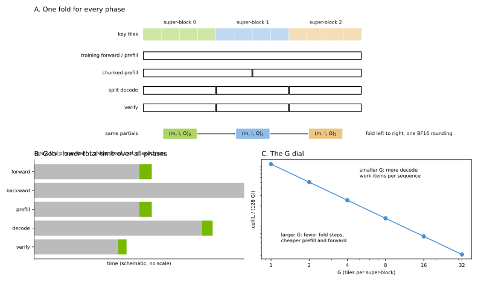

# Exact Attention

The exact attention backend (`--attention-backend exact`) gives the same output bytes for a
token in every phase of a model's life: the training forward, prefill, chunked prefill, decode,
and speculative verify. The goal is to reduce the **total** time across forward, backward,
prefill, decode, and verify with one kernel set. A model then serves the same numbers that it
trained on, and no phase has to fall back to a slow reference path to keep them equal.

## Contract

- Keys are visited in tiles of 128, aligned to the start of the sequence.
- Tiles are grouped into super-blocks of `G` tiles (`exact_attention_super_block_tiles`).
  Super-block `s` holds tiles `[G*s, G*(s+1))`, at absolute key positions.
- Inside a super-block, each query row runs an online softmax that starts from
  `m = -inf`, `l = 0` and a zero FP32 output, and produces one FP32 partial `(m, l, O)`.
- The partials of a row are folded left to right in super-block order, with one fixed
  formula. The fold rounds to BF16 once, at the end.

A query row sees the same super-blocks and the same fold in every phase. Prefill folds in the
kernel at each super-block boundary. Decode and verify compute one partial per work item and
fold the partials in a combine kernel, in the same order. Chunked prefill only changes which
call computes a row, not the tiles that the row visits. So the bytes do not depend on batch
composition, on the split of a prompt into chunks, or on the number of decode splits.

`G` is part of the bytes: two values of `G` give different (both exact) outputs. Training and
serving must use the same `G`.

## Choosing G

For a row with `L` visible keys, the number of fold steps and the number of split-decode work
items are both `ceil(L / (128 * G))`.

- A larger `G` makes fewer fold steps, so prefill and the training forward cost less.
- A smaller `G` makes more work items per sequence, so decode and verify have more parallel
  work at short and medium context.

The default is `G = 8`.

## Backward

The backward is the FlashAttention-4 backward, fed with the exact forward's output and LSE.
It is run-to-run deterministic (`deterministic=True` at head dimension 128).

## Context parallelism

- `all_gather`: K and V are all-gathered. Each rank runs its zigzag segments as varlen
  sequences whose causal mask is aligned to the end of the key range. Forward rows, LSE and
  `dQ` equal the single-GPU result byte for byte. `dK` and `dV` are sums of two BF16
  segment partials, so they are close to the single-GPU result but not byte-equal.
- `a2a`: each rank gets full sequences for its share of heads. The kernel sees the single-GPU
  problem, so all bytes are equal. The head counts must be divisible by the CP size.
- `p2p` and `a2a+p2p` are rejected: ring steps merge partials at chunk boundaries that are
  not super-block boundaries, which changes the fold.

## Limits

BF16 only, causal masks only, head dimension 128 or 256. FP8 attention, sliding windows,
logit softcapping, attention sinks, attention bias, dropout, and query-key layer scaling are
rejected when the config is built.
