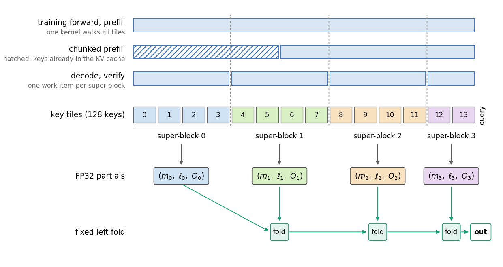
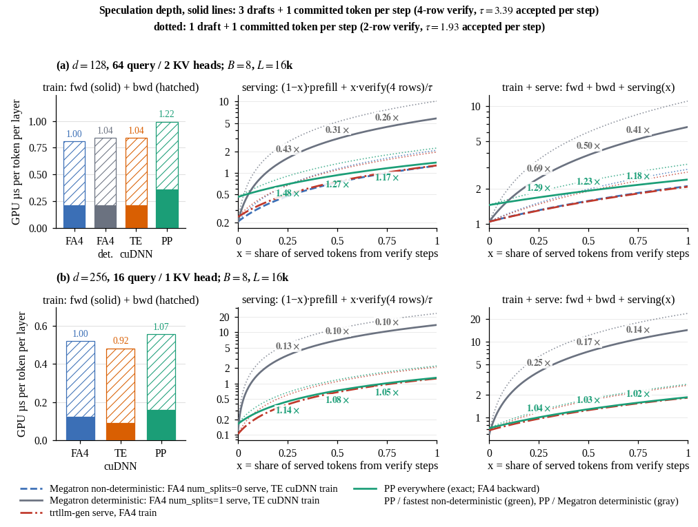
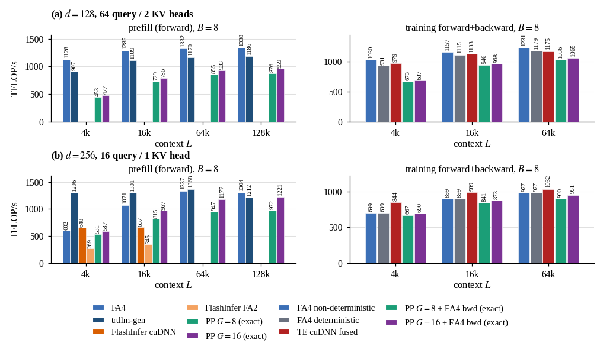

# Flash Attention Perfect Precision (PP)

The PP attention backend (`--attention-backend pp`) gives the same output bytes for a
token in every phase of a model's life: the training forward, prefill, chunked prefill, decode,
and speculative verify. The goal is to reduce the **total** time across forward, backward,
prefill, decode, and verify with one kernel set. A model then serves the same numbers that it
trained on, and no phase has to fall back to a slow reference path to keep them equal.

*Each phase splits the keys of a query row at the same super-block boundaries (`G = 4` is
shown; the default is 8). It makes one FP32 partial per super-block and folds the partials
left to right. Drawn by `docs/images/pp_attention/make_figure.py`.*

## Contract

- Keys are visited in tiles of 128, aligned to the start of the sequence.
- Tiles are grouped into super-blocks of `G` tiles (`pp_attention_super_block_tiles`).
  Super-block `s` holds tiles `[G*s, G*(s+1))`, at absolute key positions.
- Inside a super-block, each query row runs an online softmax that starts from
  `m = -inf`, `l = 0` and a zero FP32 output, and produces one FP32 partial `(m, l, O)`.
- The partials of a row are folded left to right in super-block order, with one fixed
  formula. The fold rounds to BF16 once, at the end.

A query row sees the same super-blocks and the same fold in every phase. Prefill folds in the
kernel at each super-block boundary. Decode and verify compute one partial per work item and
fold the partials in a combine kernel, in the same order. Chunked prefill only changes which
call computes a row, not the tiles that the row visits. So the bytes do not depend on batch
composition, on the split of a prompt into chunks, or on the number of decode splits.

`G` is part of the bytes: two values of `G` give different (both exact) outputs. Training and
serving must use the same `G`.

## Choosing G

For a row with `L` visible keys, the number of fold steps and the number of split-decode work
items are both `ceil(L / (128 * G))`.

- A larger `G` makes fewer fold steps, so prefill and the training forward cost less.
- A smaller `G` makes more work items per sequence, so decode and verify have more parallel
  work at short and medium context.

The default is `G = 8`.

## Total time

The figures below were measured on one SM100-class GPU with FA4, TE cuDNN and trtllm-gen as
baselines, at `B = 8` and `L = 16k` for the net cost. Shapes: head dimension 128 with 64
query and 2 KV heads, and head dimension 256 with 16 query and 1 KV head.

*GPU time per token per layer. Left: training forward (solid) and backward (hatched).
Middle: serving cost `(1 - x) * prefill + x * verify / tau` for a share `x` of the served
tokens that come from verify steps; `tau` is the number of tokens one verify step emits
(3.39 for a 4-row verify, solid; 1.93 for a 2-row verify, dotted). Right: training plus
serving. Baselines: Megatron's default stack (FA4 `num_splits=0` to serve, TE cuDNN to
train; bytes differ between phases), Megatron's deterministic stack (FA4 `num_splits=1` to
serve, TE cuDNN to train) and trtllm-gen to serve with FA4 to train. Training bars: FA4 with its
default backward, FA4 with `deterministic=True`, TE cuDNN, and PP forward plus the FA4
backward. Green ratios are PP over the fastest stack whose bytes differ; gray ratios are PP
over the deterministic stack.*

PP trains with its forward plus the FA4 backward (deterministic at head dimension 128), so
its training step takes 1.22x (head dimension 128) and 1.07x (head dimension 256) the FA4
time at `B = 8`, `L = 16k`. Its serving cost is 1.05x-1.48x the fastest stack whose bytes
differ, and its training-plus-serving cost 1.02x-1.29x. Against the deterministic stack,
which is what keeps the bytes equal today, PP takes 0.10x-0.43x the serving cost and
0.14x-0.69x the training-plus-serving cost.

*Prefill (forward) and training forward+backward throughput at `B = 8` over context. FLOPs
are `2 * B * L^2 * H_q * d` for the causal forward and 3.5x that for forward+backward. PP is
shown at `G = 8` and `G = 16`; its training bars use the FA4 backward. Training shows FA4
with the default (non-deterministic) backward and with `deterministic=True`; at head
dimension 256 FA4 has one backward, which is deterministic, so the two bars are equal.
Prefill shows FA4 once: `num_splits=1` and the default differ by under 2% at these shapes.*

## Backward

The backward is the FlashAttention-4 backward, fed with the PP forward's output and LSE.
It is run-to-run deterministic (`deterministic=True` at head dimension 128).

## Context parallelism

- `all_gather`: K and V are all-gathered. Each rank runs its zigzag segments as varlen
  sequences whose causal mask is aligned to the end of the key range. Forward rows, LSE and
  `dQ` equal the single-GPU result byte for byte. `dK` and `dV` are sums of two BF16
  segment partials, so they are close to the single-GPU result but not byte-equal.
- `a2a`: each rank gets full sequences for its share of heads. The kernel sees the single-GPU
  problem, so all bytes are equal. The head counts must be divisible by the CP size.
- `p2p` and `a2a+p2p` are rejected: ring steps merge partials at chunk boundaries that are
  not super-block boundaries, which changes the fold.

## Limits

BF16 only, causal masks only, head dimension 128 or 256. FP8 attention, sliding windows,
logit softcapping, attention sinks, attention bias, dropout, and query-key layer scaling are
rejected when the config is built.
