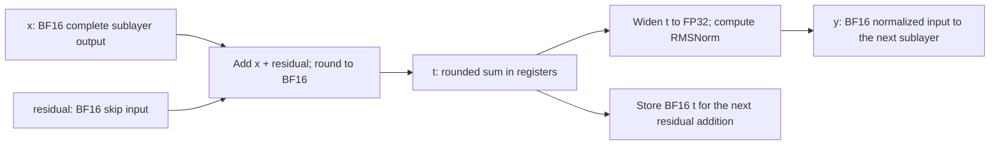

# BF16 residual addition and RMSNorm in one kernel

[`fused_bf16_add_rmsnorm`](../../megatron/core/ops/normalization/bf16_add_rmsnorm.py)
combines BF16 residual addition with RMSNorm while preserving the rounding
boundary of BF16 training. Supported `inference_optimized` hybrid layers select
it automatically. It introduces no checkpoint field, configuration flag, FP32
residual allocation, or backward implementation.

## Arithmetic contract

For a complete sublayer output `x` and its skip input `residual`, the operation
returns the normalized output `y` and next residual `t`:

```text
t = BF16(FP32(x) + FP32(residual))
v = FP32(t)
y = BF16((v * inverse_rms(v)) * FP32(weight))
return y, t
```

Both the numerator and sum of squares use the BF16-rounded value `t`. Rounding
occurs in registers; fusion removes the intermediate global-memory reload
without removing this rounding step. For a boundary after an MoE block, `x`
means the complete output after combining the routed and shared experts.



The numerical target is Transformer Engine **2.15.0+42b84005**, native RMSNorm
with BF16 activations and weights. The primitive accepts hidden sizes divisible
by eight from 8 through 8192. It reproduces both native dispatch families:

- Sequential per-thread FP32 FMA accumulation of squares in vector/chunk order.
- The general kernel's per-warp reduction order and, for widths above 2048,
  sequential addition of four warp totals.
- The tuned kernel's mean/variance calculation, including Chan's merge of four
  warp populations at 4096 and 8192. TE selects this family at its registered
  widths when the row count is divisible by four and pointers are aligned.
- The native FMA association for inverse RMS, followed by reciprocal square root.
- The order of normalization and weight multiplication, then BF16 conversion.

Zero-centered gamma adds one to the weight in FP32. A generic reduction of the
same mathematical formula need not produce identical bits.

The reference arithmetic is documented in TE's
[general RMSNorm kernel](https://github.com/NVIDIA/TransformerEngine/blob/42b84005/transformer_engine/common/normalization/rmsnorm/rmsnorm_fwd_kernels.cuh)
and [reduction helpers](https://github.com/NVIDIA/TransformerEngine/blob/42b84005/transformer_engine/common/utils.cuh).

## Calling and storage ownership

```python
import torch

from megatron.core.ops.normalization.bf16_add_rmsnorm import fused_bf16_add_rmsnorm

with torch.no_grad():
    normalized, next_residual = fused_bf16_add_rmsnorm(
        x, residual, norm.weight, eps=norm.eps, inplace=True
    )
```

Inputs must be contiguous CUDA BF16 tensors on the same device. The two
activation tensors have identical shapes `[..., hidden]`; the weight has shape
`(hidden,)`. Epsilon must be a finite positive normal FP32 value. Empty batches
are accepted. Inputs requiring autograd are rejected when grad mode is enabled.

| Mode | Normalized output | Returned residual | Ownership requirement |
|---|---|---|---|
| Default, `inplace=False` | New BF16 tensor | New BF16 tensor | Inputs remain unchanged |
| `inplace=True` | New BF16 tensor | Reuses and overwrites `x` | Caller owns `x`; no remaining readers of its old contents |

In-place mode rejects `x` sharing storage with either the input residual or
weight. Input residual and weight are never overwritten. Neither mode allocates
a tensor containing the FP32 sum; the FP32 normalization values stay in registers.
Compared with native in-place BF16 addition plus TE RMSNorm, buffer reuse needs
no additional live tensor. The default out-of-place mode adds one BF16 tensor
relative to that in-place baseline; compare it with an out-of-place baseline
when assessing the cost of the fusion itself.

Per-layer CUDA graphs can retain additional BF16 normalized-output buffers
across layer boundaries. The primitive's live-allocation equivalence does not
imply zero additional graph storage; measure the captured model at its actual
token capacities when assessing memory use.

Warm up the primitive before CUDA graph capture. Replays reuse captured output
addresses, and weight refits must copy into the existing weight storage. For
in-place replay, the producer must refresh `x` before each execution.

## Validation and reproduction

The focused tests use Megatron training bias/dropout/add with no bias and zero
dropout, followed by an actual TE RMSNorm module in training mode with autograd
enabled. Both outputs are compared as integer bit patterns. Coverage includes:

- Several row counts through 4096, higher-rank and empty inputs.
- General/tuned dispatch across widths from 8 through 8192.
- Epsilon 1e-5 and 1e-6, ordinary and zero-centered gamma.
- Rounding ties, cancellation, signed zeros, subnormal values and overflow.
- Compiled training residual addition, both storage modes, and alias rejection.
- CUDA graph replay after changing activations and copying new weights.
- Bit-exact replay under side-stream contention.

Run in a CUDA environment with PyTorch, Triton, TE and pytest installed:

```bash
PYTHONPATH=. uv run python -m torch.distributed.run --standalone --nproc-per-node=4 \
  -m pytest --noconftest -q \
  tests/unit_tests/ops/test_bf16_add_rmsnorm.py \
  tests/unit_tests/ops/test_normalization_backends.py \
  tests/unit_tests/models/test_inference_residual_norm.py \
  tests/unit_tests/determinism/kernels/test_bf16_add_rmsnorm.py \
  tests/unit_tests/determinism/kernels/test_manifest.py

PYTHONPATH=. uv run python -m torch.distributed.run --standalone --nproc-per-node=4 \
  tests/performance_tests/benchmark_bf16_add_rmsnorm.py \
  --output-dir /tmp/bf16-rmsnorm-results

PYTHONPATH=. uv run python -m torch.distributed.run --standalone --nproc-per-node=4 \
  tests/performance_tests/benchmark_bf16_add_rmsnorm.py \
  --compare-approaches --hidden-sizes 2688 4096 8192 --rows 1 2 8 32 128 2048 \
  --output-dir /tmp/bf16-rmsnorm-comparison
```

`--noconftest` isolates these self-contained kernel tests from the full suite's
model/data setup. This is a focused validation run, not a full CI run. Select
the native TE backend for the arithmetic contract above; the primitive does
not inspect or change TE backend settings.

The benchmark writes a JSON-lines file for each rank with package versions,
GPU, environment settings, source hash, allocation sizes and timings. Its
original two-path mode asserts exact outputs and checks a synthetic 52-boundary
feedback chain. Comparison mode measures numerical differences among all four
implementations. Each graph contains 64 boundaries to amortize replay-launch
overhead; each timing is the median of seven batches of 20 graph replays.
All compared paths include identical input-reset copies. Allocation measurements
use PyTorch's live and peak allocation counters after warmup, with outputs retained.

## Automatic inference selection

The hybrid stack binds an execution plan at construction for ordinary Mamba,
self-attention-only and MoE-only layers. Each layer produces two explicit
tensors: its BF16-rounded residual and the normalized input for the following
layer. Per-layer CUDA graphs link both tensors; the projection consumes the
already-normalized input while retaining its tensor-parallel all-gather.
The final residual addition also fuses with the final RMSNorm when present.

Weights remain owned by the original modules. Checkpoint keys do not change,
and norm refits copy into the same captured weight storage. Expert arithmetic,
routing, shared-expert combination and communication implementations are
unchanged. `fp32_residual_connection=True` retains its existing behavior.

Selection currently requires Blackwell, PyTorch 2.11, Triton 3.6 and the TE
revision above, with native TE normalization. Unsupported installations or
layer/configuration combinations use the existing model path. The optimization
is inference-only and requires disabled gradients, BF16 contiguous activations
and weights, RMSNorm, no bias or dropout, and ordinary residual connections.
Quantized layers, zero-centered-gamma model integration, context parallelism,
TP communication fusion, alternative normalization backends, dense combined
Transformer layers, GDN/MLA and custom layer subclasses retain the native path.

Validation includes native hybrid prefill/decode comparisons, CUDA graph replay
after activation and norm-weight changes, and four-rank TP gathers through both
NCCL and NVLS. These are small models using production layer classes, not a
production checkpoint or EP64 rollout benchmark.

## Comparing implementations

The optional benchmark comparison requires FlashInfer. It measures native
BF16 addition plus TE RMSNorm, this fusion, BF16 addition plus standalone
FlashInfer RMSNorm, and FlashInfer's fused add/RMSNorm. All timed paths include
two identical copies refreshing preallocated BF16 working inputs. FlashInfer's
fused operation overwrites both working inputs; the other paths preserve the
working skip input and allocate a normalized output. Memory results report
that ownership difference explicitly.

Numerical results report exact output/residual agreement with TE training and
FP64 errors for both the exact sum and the BF16-rounded sum. Those are different
targets: reducing error against the unrounded sum need not agree with training.
Random, cancellation, rounding-tie and large-offset inputs are included.

Bit equality is established only for the tested local contract. It is not a
guarantee for cuDNN RMSNorm, other TE/compiler/GPU versions, different widths or
dtypes, nonzero dropout, or the entire model. Preserving training rounding does
not claim to minimize error against an ideal FP64 computation. Full-model
logits, rollout/training log probabilities and task quality require separate
end-to-end validation.
