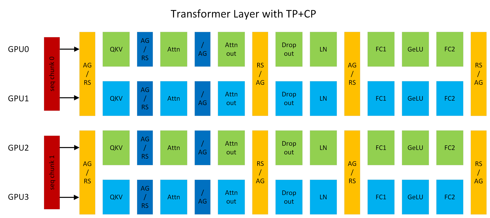
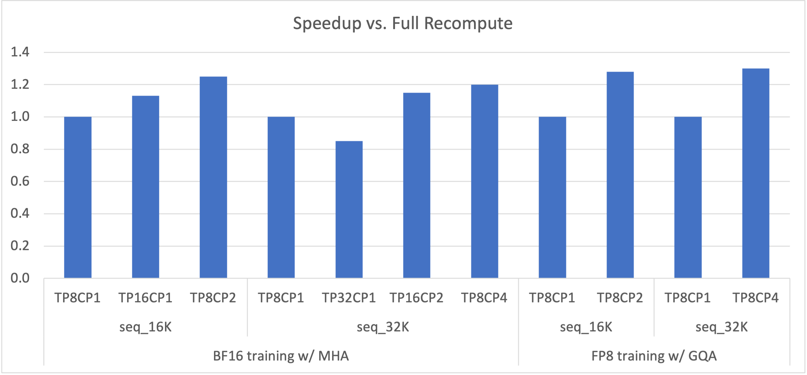

{/*
   Copyright (c) 2022-2026, NVIDIA CORPORATION. All rights reserved.
   NVIDIA CORPORATION and its licensors retain all intellectual property
   and proprietary rights in and to this software, related documentation
   and any modifications thereto. Any use, reproduction, disclosure or
   distribution of this software and related documentation without an express
   license agreement from NVIDIA CORPORATION is strictly prohibited.
*/}

# Context Parallel Overview

Figure 1: A transformer layer running with TP2CP2. Communications next to Attention are for CP, others are for TP. (AG/RS: all-gather in forward and reduce-scatter in backward, RS/AG: reduce-scatter in forward and all-gather in backward, /AG: no-op in forward and all-gather in backward).

Context Parallelism (CP) is a parallelization scheme on the sequence-length dimension. Unlike prior SP (sequence parallelism), which only splits the sequence of Dropout and LayerNorm activations, CP partitions the network inputs and all activations along the sequence dimension. With CP, all modules except attention (for example, Linear and LayerNorm) can work as usual without any changes, because they do not have inter-token operations. For attention, the Q (query) of each token must combine with the KV (key and value) of all tokens in the same sequence. CP therefore requires an additional all-gather across GPUs to collect the full sequence of KV. Correspondingly, reduce-scatter is applied to the activation gradients of KV in backward propagation. To reduce activation memory footprint, each GPU stores only the KV of a sequence chunk in forward and gathers KV again in backward. KV communication happens between a GPU and its counterparts in other TP groups. The all-gather and reduce-scatter are implemented as point-to-point communications in a ring topology. Exchanging KV can also leverage MQA or GQA to reduce communication volume, because those variants use one or a few attention heads for KV.

For example, in Figure 1, if the sequence length is 8K, each GPU processes 4K tokens. GPU0 and GPU2 form a CP group and exchange KV with each other; the same pattern applies between GPU1 and GPU3. CP is similar to [Ring Attention](https://arxiv.org/abs/2310.01889) but targets higher performance by (1) using current open-source and cuDNN flash attention kernels, and (2) avoiding extra work from lower-triangle causal masking while keeping load balanced across GPUs.

## Context Parallelism Benefits

Figure 2: Speedup of 175B GPT with various TP+CP combinations compared to full recomputation (that is, TP8CP1).

An LLM can hit an out-of-memory (OOM) error on long contexts (long sequence lengths) because activation memory grows about linearly with sequence length. Recomputing activations in backward can avoid OOM but adds significant overhead (about 30 percent with full recomputation). Increasing TP (tensor model parallelism) can also fix OOM, but it can make compute in layers such as Linear too short to hide communication latency. Scaling to more GPUs with larger TP can hit that overlap limit even when OOM is not the driver.

CP addresses these tradeoffs. With CP, each GPU computes on part of the sequence, which scales down both compute and communication by the CP degree. Overlap between them is less of a concern. The activation memory footprint per GPU is also smaller by the CP degree, which reduces OOM risk. As Figure 2 shows, TP and CP together can outperform full recomputation by removing most recompute overhead and balancing compute against communication.

## Enabling Context Parallelism

CP support is included on the GPT code path. Other models that share that path, such as LLaMA, can use CP as well. CP works with TP (tensor model parallelism), PP (pipeline model parallelism), and DP (data parallelism). The total GPU count is TP × CP × PP × DP. CP also works with different attention variants, including MHA, MQA, and GQA, with unidirectional or bidirectional masking.

Enable CP by setting `context_parallel_size=<CP_SIZE>` on the command line. The default `context_parallel_size` is 1, which disables CP. Running with CP requires Megatron Core (>=0.5.0) and Transformer Engine (>=1.1).

## Dynamic context parallelism

Dynamic CP assigns a CP group to each packed microbatch according to its sequence
lengths. Short sequences can use CP1 while longer sequences share the same DP×CP
domain at CP2, CP4, and other enabled sizes. The model's build-time group remains
unchanged. Enable it with `--dynamic-context-parallel --use-varlen-dataset
--sequence-packing-scheduler default_dynamic_cp --calculate-per-token-loss`, and
set `--max-seqlen-per-dp-cp-rank` to the token capacity of one rank.
`--min-dynamic-context-parallel-size` sets the smallest group the scheduler may
select (default 1). The largest selectable group spans the DP×CP domain; there is
currently no independent maximum-size option.

GPT and Hybrid models propagate the selected groups through packed microbatch
metadata. Runtime CP is supported by standard attention, MLA and absorbed MLA,
DSA with the MLA path, Mamba, GDN/GDN2, GDP, hybrid layout conversion, and MTP.
Sequence parallelism also carries the matching TP×CP group. CSA and DSA-GQA do
not support dynamic CP; DeepSeek-V4 is not supported.

The following constraints apply:

- Use per-token loss and variable-length packed training data. Dynamic CP does
  not support deterministic mode, CUDA graphs, or router z-loss.
- Headwise Mamba, GDP, and GDN/GDN2 require their TP-local head/group geometry
  to divide **every** CP size the scheduler can select. Construction validates
  this against the caller's DP×CP group, before a long sequence reaches forward.
- Mamba does not support chunkwise CP. Chunkwise GDP keeps all TP-local heads,
  avoids the head-sharding divisibility restriction, and is recommended when
  dynamic CP would select more ranks than the head geometry supports.
- Inference uses CP1. These runtime training groups do not enable CP inference.

MTP with `--calculate-per-token-loss` sums the main and MTP valid-token counts
over the effective CP group before scaling gradients. This also corrects static
CP>1 runs whose ranks have different valid-token counts; it adds a two-element
all-reduce per MTP depth per microbatch. Logged `mtp_N loss` is a global
token-weighted mean, including under static CP, so packed or masked runs may log
different values from older mean-of-microbatch-means metrics.

## Layout conversion contract

`megatron.core.context_parallel.convert_cp_partition_mode` accepts concrete
`source_partition_mode` and `target_partition_mode` values (`zigzag` or
`contiguous`). It calls the same implementation as `convert_cp_layout`;
there is no separate partition-mode communication backend. `seq_dim` selects
the tensor's sequence axis. With sequence parallelism, callers must supply the
matching TP and TP×CP groups.

For packed tensors, prepare a `ContextParallelBatch` through
`get_batches_on_this_cp_rank`, request both physical layouts, and pass its
`thd_plan` to conversion. The plan supports different physical token counts on
the two sides and combines TP×CP redistribution in one all-to-all. The consumer
must use `batch.get_packed_seq_params(target_layout)` as well as the converted
tensor. Changing only `PackedSeqParams.cp_partition_mode` is incorrect when
zigzag attention adds padding. Logical boundaries and physical padded
boundaries remain distinct; empty documents are allowed within a nonempty pack.

Batch views annotate metadata with its concrete layout. Wrapping metadata
whose layout is unspecified makes a shallow metadata copy, without rebuilding
its precomputed tensors or modifying the caller's object. Contradictory layout
annotations are rejected. The annotation is MCore-only and is not passed to
Transformer Engine.

The low-level `get_batch_on_this_cp_rank` dispatcher accepts
`cp_partition_mode` as a spelling of its existing contiguous/zigzag selection.
It validates conflicts with `use_contiguous_cp`; it does not merely annotate
the returned tokens. `auto` selects a configuration default, not a physical ordering,
and is rejected by these tensor and batch APIs.

### Configuration-time layout resolution

The user-facing controls are:

| Field / CLI flag | Values | Default resolution |
| --- | --- | --- |
| `linear_cp_mode` / `--linear-cp-mode` | `headwise`, `chunkwise` | `headwise`; no `auto` algorithm |
| `linear_attention_cp_layout` / `--linear-attention-cp-layout` | `auto`, `contiguous`, `zigzag` | Headwise -> zigzag; chunkwise -> contiguous |
| `attention_cp_layout` / `--attention-cp-layout` | `auto`, `contiguous`, `zigzag` | Zigzag, or contiguous for the configured DSv4 hybrid variant |
| `global_cp_layout` / `--global-cp-layout` | `auto`, `contiguous`, `zigzag` | The resolved linear layout |

All three layout defaults are resolved in `TransformerConfig.__post_init__`,
before module construction. An explicit concrete value is never overwritten.
The resulting configuration, including its serialized representation, contains
concrete layouts. Modules read these values; they do not resolve defaults during
forward. The selected kernel checks its supported layouts during construction.

`global_cp_layout` is the default CP layout for parts without a separate layout
policy. It determines input partitioning and the backbone residual boundary,
including token alignment for MLP/MoE. A module's compute-layout `auto` uses its
own resolution rule, rather than inheriting the global layout. For example,
global contiguous with ordinary attention auto keeps the residual in contiguous
layout while the attention branch uses zigzag and restores contiguous before
the residual write. A separate policy need not be an explicit CLI value.

This first-stage rule does not inspect the actual layer pattern or optimize a
cost model. In particular, an unused linear-layout setting can still determine
the residual layout of a full-attention-only model. Set `global_cp_layout`
explicitly when that default is unsuitable. Architecture-aware default selection
and finer optimization policies are separate work.

`linear_cp_layout` remains an input compatibility alias for
`linear_attention_cp_layout`; concrete `cp_partition_mode` values alias
`global_cp_layout`. Conflicting aliases are rejected. The former
`cp_partition_mode=auto` layer-run policy is rejected rather than silently
reinterpreted as the new configuration-time default.

Update the previous draft's `residual_state_layout` field and
`--residual-state-layout` flag to `global_cp_layout` and `--global-cp-layout`.

### Computation branches own conversion

Residual state, masks and token IDs keep their boundary layout throughout a
stack. Self-attention/mixer branches convert to their resolved compute layout
after reading the residual, then restore the boundary before BDA/residual writes.
The same boundary holds during checkpoint recomputation and Shortcut-MoE
execution. The stack only composes modules and supplies runtime metadata; it
does not transpose the entire residual state.

The removed `ContextParallelLayoutManager` / `ContextParallelLayoutState`
layer-run orchestration is replaced by `prepare_module_cp_input` and its
call-local reverse converter. Two-stage execution carries that converter with
its intermediate result, so interleaved calls do not overwrite shared state.

External custom layers retain their supplied config objects. Their shared invocation
adapter aligns activations, token IDs and padding masks with the declared input layout,
then restores the stack boundary on return, including under recomputation and mHC.
The adapter reuses the same conversion backend; it does not convert persistent residual history.
After cloning a config, update the canonical layout fields rather than their input aliases.

A module whose input and compute layouts already match performs no layout
conversion. Runtime CP1 likewise requires no communication or route. A kernel
supporting an alternate native layout can declare and validate that support,
allowing an explicit compute-layout override without adding another conversion
backend. Current GDN/KDA implementations require zigzag for headwise and
contiguous for chunkwise; the existing headwise Mamba path supports either.
A layout override alone does not add a kernel capability.

### Producer metadata and MTP

GPT/Hybrid pretraining and packing-scheduler producers prepare the requested
batch views once. `ContextParallelBatch.prepare_module_layouts()` attaches
acyclic `CPLayoutViews`: leaves have no back reference, tensors and the canonical
plan are reused, and module calls neither copy metadata nor build routes.
RoPE preparation covers the largest physical sequence length among the views.

MIMO and LLaVA inputs use the global boundary policy; packed LLaVA metadata uses
the shared producer and conversion plan. Offline teacher-logit
cache readers and writers use the same policy to preserve token order. Fixed-length
inter-document batches keep whole-sample zigzag partitioning when no alternate
layout is requested; per-document padding must not enlarge their pipeline tensors.

Metadata-only callers can use `finalize_packed_seq_params` at batch preparation
and must use its return value. Existing stack callers supplying both the
metadata dictionary and plan are adapted to the same views without rebuilding
routes. Already-sharded zigzag input whose physical padding metadata is
insufficient is rejected; prepare that batch from its unsliced input instead.

Chunkwise recurrence metadata is built from the contiguous consumer view, not
from differently padded residual metadata. CP and TP×CP groups are resolved
from the same microbatch context; no shared module group is mutated.

Hybrid MTP retains its configured rolling/attention boundary and token/mask
views. MTP resolves its source from the actual batch or tagged metadata, falling
back to the concrete residual policy. Cross-layout MTP requires the complete
`ContextParallelBatch`, including token, label and mask views; metadata-only
adapters cannot fabricate these tensors. GPT MTP requires matching residual and
attention layouts when CP is active.

### Kernel and capture boundaries

TE self-attention also supports static contiguous CP with
`cp_comm_type="all_gather"` and a TE build exposing
`CPLoadBalancingStrategy.NO_LOAD_BALANCE`. Its backend validates the supported
mask, input format, and communication mode. Rotary embeddings are not yet
supported on this path. The packing scheduler/dynamic-CP
combination and GPTModel contiguous attention remain rejected as on main.
This is attention communication; layout redistribution still uses the canonical
TP×CP conversion backend. DSA keeps its separate zigzag requirement.

GDN1 FLA chunkwise CP retains all TP-local heads and shares one CP context between
convolution and recurrence. Static contexts are cached by runtime group/shape;
THD contexts are reused within the microbatch. This path requires unfused FLA,
THD or SBHD batch size one, no independent local convolution padding, and eager
execution. GDN2 remains headwise-only; torch/TE do not silently replace FLA.

Actual module layout conversion requires implicit attention masking, no dense
attention bias, and no cross-attention, and is currently training-only.
THD module views and conversion inside attention/mixer/full CUDA Graph capture
are not supported. SBHD conversion may remain outside an MLP-only graph.
No automatic full-iteration capture or bit-exact equivalence between distinct
token partitions is implied.

The old `megatron.core.context_parallel_layout` import path provides thin
module/conversion exports. The equal-length `ThdCpRoute` constructor is not
retained; callers use `THDCPLayoutPlan` and the matching target metadata.
