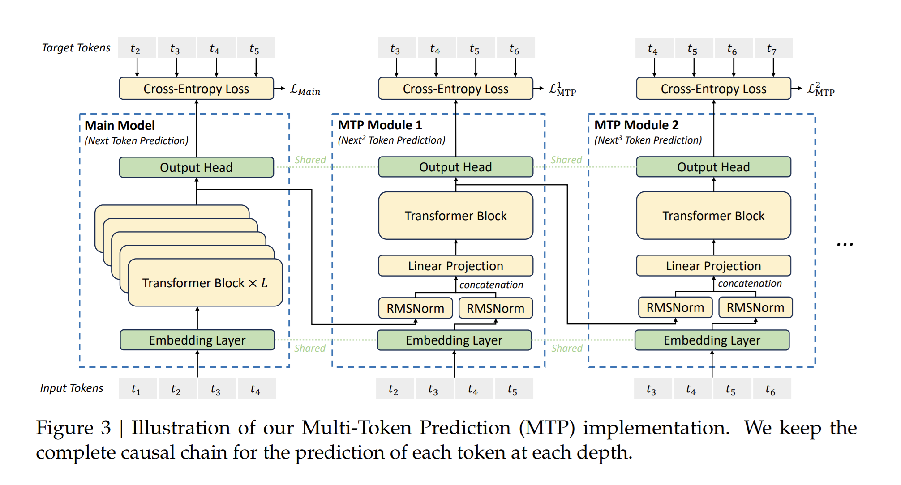

<!---
   Copyright (c) 2022-2026, NVIDIA CORPORATION. All rights reserved.
   NVIDIA CORPORATION and its licensors retain all intellectual property
   and proprietary rights in and to this software, related documentation
   and any modifications thereto. Any use, reproduction, disclosure or
   distribution of this software and related documentation without an express
   license agreement from NVIDIA CORPORATION is strictly prohibited.
-->

# Multi-Token Prediction (MTP)

Multi-Token Prediction (MTP) extends the prediction scope to several future tokens at each position. An MTP objective adds extra prediction targets, which can improve data efficiency. It may also encourage representations that anticipate later tokens. This implementation predicts additional tokens in sequence and preserves the causal dependency chain at each depth. The following figure illustrates MTP as used in [DeepSeek-V3](https://github.com/deepseek-ai/DeepSeek-V3/).



The *k*-th MTP module includes a shared embedding layer, a projection matrix, a Transformer block, and a shared output head. For the *i*-th input token at depth *k - 1*, the implementation combines the representation of the *i*-th token and the embedding of the *(i + K)*-th token with a linear projection. That combined representation is the input to the Transformer block at depth *k*, which produces the output representation.

For more detail, refer to the [DeepSeek-V3 technical report](https://arxiv.org/pdf/2412.19437.pdf).

## Related Arguments

Train `GPTModel`-style models with MTP by setting `mtp_num_layers` to a positive integer.

The following table summarizes MTP configuration fields:

| Item | Description |
| --- | --- |
| `mtp_num_layers` | Number of MTP layers. MTP extends prediction to multiple future tokens at each position. This stack uses `mtp_num_layers` sequential modules to predict that many additional tokens per position. Default: `None`. |
| `mtp_loss_scaling_factor` | Weight for the MTP loss term. The implementation averages MTP losses across depths, multiplies by this factor, and adds the result to the training objective. Default: `0.1`. |
| `mtp_loss_type` | MTP training objective: `cross_entropy` or `e2e_tv`. Default: `cross_entropy`. |

## End-to-End TV Loss

Set `mtp_loss_type: e2e_tv` to select the end-to-end TV objective when MTP is enabled.
This mode automatically enables `mtp_detach_heads` with a warning if it was disabled,
preventing MTP loss gradients from flowing into the main model. Set
`mtp_detach_heads: true` explicitly to avoid the warning. The auxiliary loss is
scaled by `mtp_loss_scaling_factor`. To train only MTP parameters, the optimizer
must additionally freeze the base model or select only MTP parameters; `mtp_detach_heads` does not
change the optimizer parameter set. See
[Bebop](https://arxiv.org/abs/2606.12370) for the objective definition.

The fused TV kernel supports FP16, BF16, and FP32 logits. Softmax statistics,
vocabulary reductions, and the TV and prefix loss outputs use FP32; draft-logit
gradients are returned in the draft logits' dtype.

## Pipeline Parallel Layout for MTP

MTP supports user-defined placement of MTP layers across pipeline stages through `pipeline_model_parallel_layout`. By default, all MTP layers sit on the last pipeline stage; you can override placement in the layout string.

### MTP Standalone Mode

When MTP layers are placed in a separate virtual pipeline (VPP) stage that is not on the last pipeline rank, the `mtp_standalone` flag is automatically set to `True`. MTP then runs in its own pipeline stage.

### Layout Format

Use `m` for MTP layers in the pipeline layout string. For example:
- `"E|t*3|(t|)*5mL"` - MTP in the last stage
- `"E|t*3|(t|)*4tm|L"` - MTP in the second-to-last stage with a decoder layer
- `"E|t*3|(t|)*3tt|m|L"` - MTP in a standalone stage (second-to-last) with no other layers

### Constraints

- Place all MTP layers in the same virtual pipeline stage.
- Do not place MTP layers on the first pipeline rank.

## Implementation Notes

- For models with MTP layers, the final LayerNorm sits in the stage that contains the last decoder layer, not in the post-process stage. That can change gradient norm reduction slightly in deterministic mode when LayerNorm would otherwise live in another stage. For bitwise alignment, disable gradient norm clipping.
- MTP loss is computed in the post-processing stage.
- Both MTP objectives use the caller-provided `dp_cp_group` for training loss and
  acceptance logging. If omitted, they use the default MPU data-and-context-parallel
  group. Evaluation does not require this logging group.

## Unsupported Combinations

Arbitrary `AttnMaskType` and learned absolute position embeddings are not supported
with MTP. Static and dynamic context parallelism are supported with packed data;
dynamic CP requires per-token loss. See [dynamic context parallelism](context_parallel.md#dynamic-context-parallelism)
for runtime group requirements and the per-token gradient and logging behavior.

## K3-style Hybrid Attention Residuals and MTP

Hybrid MTP can combine Kimi Delta Attention (`K`), gated MLA (`+`), dense MLP
(`-`), and MoE (`E`) with `enable_attention_residuals=True`. This integrates the
K3 residual structure into MCore's existing MTP embedding shift, projection,
prediction head, and auxiliary loss. It does not claim to reproduce K3's
unpublished training-time MTP topology. The source reference is
[Kimi-K3 at f831ab6](https://huggingface.co/moonshotai/Kimi-K3/tree/f831ab66814297da540d832a5235f8e904f29d06),
`modeling_kimi_linear.py`, specifically `_apply_attn_res` and
`KimiDecoderLayer._forward_attn_residual`.

### Residual state and layer counting

Hybrid patterns count attention and FFN as separate entries: K3's block size of
12 physical decoder layers maps to `attn_res_block_layers=24`, not 12. For
example, a 16-pair training proxy can use
`K-KEKE+EKEKEKE+EKEKEKE+EKEKEKE+E/+E` with `num_layers=32` and
`mtp_num_layers=1`. Append another `/+E` for two MTP depths. The trunk may use
`|` for pipeline boundaries; MTP remains on the last stage. FLA is the default
AttnRes backend; `attn_res_impl=compile` explicitly selects the compiled path.
For K3's MLA NoPE, set `no_rope_freq=1` and keep `qk_pos_emb_head_dim=64`:
these shared key/query channels are still projected, but are not rotated.
MLA's `no_rope_freq` path currently supports training, not cached inference.
Use `qk_layernorm=True` for K3's query/key-value latent norms. SiTU-GLU can use
the existing native activation path (`use_te_activation_func=False`) on images
without TE's SiTUGLU operation; selecting `situ_glu` preserves that choice.
KDA's short convolutions use SiLU independently of the FFN activation, including
when the FFN uses SiTU-GLU. Both native and fused convolution paths follow this
rule from the reference implementation.

The trunk exports an immutable tuple of the embedding, completed residual
blocks, and final partial **before** its output aggregation and normalization.
Every MTP depth reads that same tuple. Its projected embedding/previous-hidden
combination initializes a fresh local partial, and each nested entry attends
over the trunk tuple plus that partial. The entry's bias/dropout contribution
is added directly to the partial, without reconstructing a delta by subtracting
BF16 tensors. Normal module hooks and selective recomputation are preserved.
Hybrid AttnRes wrappers also forward the stack's
`strict_runtime_validation_frequency` decisions to supported attention modules,
including GDN/KDA, in both the trunk and nested MTP stacks. The split-entry delta
path carries that decision through the normal module call into attention.

At the end of each MTP depth, aggregate the trunk tuple plus its final partial
once, then apply the existing MTP output norm. The result feeds the next depth's
projection, but is never appended to the trunk tuple. `mtp_detach_heads` detaches
the hidden state, all trunk sources, and shifted embeddings while retaining
gradients for MTP parameters. Repeated MTP layers share parameters, not mutable
residual history. There is no module-level cache of sources across microbatches.

Start training validation without activation offloading or recomputation, then
enable existing selective recomputation independently. This support does not
extend full-layer recomputation, CUDA graphs, standalone MTP pipeline placement,
or the existing activation-offload module allowlist. The broader offloading
follow-up is developed on a separate branch.

The K3-specific GPU tests include independent native-Torch output/input/parameter
gradient comparisons, full-dimension NoPE MLA, and ten optimizer updates with
real KDA/MLA/MoE and two MTP depths. Reduced end-to-end training has been verified
for single-GPU MTP1/MTP2 and TP2 with sequence parallelism. PP2 validation was
interrupted by cluster SSH loss; K3 end-to-end selective-recompute, compile, and
checkpoint-resume runs remain pending. This is not a complete distributed
training support matrix.

### Attention Residual FLOPs accounting

The training FLOPs estimator includes the two AttnRes hidden-width contractions
(depth scoring and weighted-value aggregation). With `T` real tokens, hidden
width `H`, and `A` total source visits across aggregations, their forward cost
is `4 * T * H * A`; the existing global forward/backward factor is applied once
to give `12 * T * H * A`. RMSNorm and depth softmax are excluded by convention.
This is nominal model work, not measured GPU-kernel work: fusion, recomputation,
offloading, and the single-source identity shortcut do not change this estimate.

Only trunk layers grow the depth-source history. The trunk output has
`F = floor((L - 1) / B) + 2` sources, where `L` and block size `B` use the same
units: Transformer layers for GPT, pattern entries for hybrid. Pipeline `|`
separators do not count as entries or reset this history. Each MTP depth reads
those `F` trunk sources plus its fresh partial. GPT adds three aggregations per
depth (attention, MLP, output); a hybrid MTP pattern of `m` entries adds `m + 1`.
Thus each depth contributes `(m + 1) * (F + 1)` source visits, with `m = 2` for
GPT. Reusing MTP parameters does not eliminate any depth's computation.

For example, `K-+E/+E/+E` with `B = 2` has 11 trunk source visits and
`2 * 3 * 4 = 24` MTP source visits, for 35 total. Concatenating MTP entries onto
the trunk incorrectly gives 29. Packed-sequence estimates scale this work by
the real token count, independently of the attention `sum(sequence_length^2)`
term.

`tests/unit_tests/test_num_floating_point_operations.py` covers the scalar
formula and CUDA/NCCL sequence-statistics accumulation. Its topology matrix
requires eight global ranks (for example, two four-GPU GB200 nodes); the file
is selected by the `launch_on_gb200` CI marker. Multi-node tests must use
torchrun's global `RANK` for process-group membership, not the per-node
`LOCAL_RANK`. The launcher must supply the same master address to both nodes.
On a shared checkout, the CI runner writes and combines node-specific coverage
files (`.coverage.node0`, `.coverage.node1`, and so on) to avoid concurrent
mergers consuming each other's inputs; single-node output stays `.coverage`.


## Knowledge distillation from the main model

MTP can learn from the main model's next-token distribution, aligned to each
MTP depth. The main model supplies a detached teacher through the shared output
projection; the student is the corresponding MTP head. The per-token objective is

```text
mtp_ce_loss_weight * CE(labels, student)
  + mtp_kl_loss_weight * S * KL(softmax(teacher / T) || softmax(student / T))
```

Here `T` is `mtp_kd_logit_temperature`, and `S` is `mtp_kd_loss_scale`.
Leaving `--mtp-kd-loss-scale` unset uses `S = T^2`, preserving the default
loss and gradients. Set it to a finite nonnegative value to replace that
multiplier; for example, `--mtp-kd-loss-scale 1` uses unscaled KL. This scale
applies only to KD, before `mtp_kl_loss_weight`; CE is unaffected.
The existing
`mtp_loss_scaling_factor / mtp_num_layers`, loss masks, and token normalization
apply to the combined objective. Weights must be finite and nonnegative; they
need not sum to one. Temperature must be finite and positive.

Defaults (`--mtp-ce-loss-weight 1 --mtp-kl-loss-weight 0`) preserve CE-only
training and avoid computing teacher logits. For KD-only training use:

```bash
--mtp-num-layers 2 \
--mtp-ce-loss-weight 0 \
--mtp-kl-loss-weight 1 \
--mtp-kd-logit-temperature 2
```

For a mixture, use e.g. `--mtp-ce-loss-weight 0.3 --mtp-kl-loss-weight 0.7`.
KL is training-only, matching the source implementation: evaluation computes
only the weighted CE component, and KD-only evaluation attaches no MTP loss.
Setting both weights to zero disables the MTP auxiliary loss.

Teacher projection is performed before sequence shifting, preserving sequence
parallelism. Teacher logits and their cached full-vocabulary normalizers are
shifted with packed document boundaries and the configured context-parallel
layout. Vocabulary-parallel KL uses global normalizers and reductions without
all-gathering vocabulary logits. The backward recomputes probabilities and never
backpropagates through the teacher. Student output-head gradients follow the
existing `mtp_detach_heads` setting. Early backward remains available; it still
retains teacher logits in addition to the current student's logits.

`mtp_N loss` reports the weighted CE + KL objective before overall MTP scaling,
including in KD-only training. `mtp_N ce_loss` reports unweighted CE when enabled;
`mtp_N kd_logit_loss` reports KL with `S` applied, before `mtp_kl_loss_weight`,
when enabled.
The combined loss and CE metric retain upstream microbatch/rank mean averaging
by default; with per-token loss enabled they use globally reduced token sums and
counts. KL retains its token-count-weighted aggregation. With uneven token counts these
aggregations differ, so the logged combined loss need not equal a weighted sum
of the two logged component metrics.
Acceptance metrics remain available for KD-only training. KL logging divides
accumulated loss sums by accumulated counts; an empty microbatch contributes a
zero sum and a count of one, matching the source branch. The KL metric is not
scaled by the logging microbatch factor a second time.

The local sum-exp, KL, and gradient helpers use `torch.compile(dynamic=False)`
by default. Set `MTP_KD_DISABLE_COMPILE=1` before
starting Python to use eager PyTorch instead. Compilation adds first-use latency;
steady-state performance depends on the shapes and runtime. Distributed
collectives remain outside the compiled helpers.
