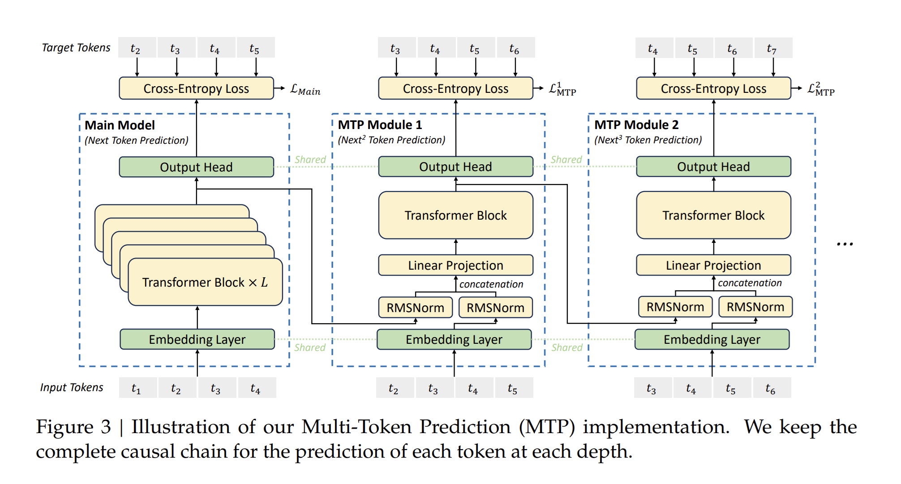

<!---
   Copyright (c) 2022-2026, NVIDIA CORPORATION. All rights reserved.
   NVIDIA CORPORATION and its licensors retain all intellectual property
   and proprietary rights in and to this software, related documentation
   and any modifications thereto. Any use, reproduction, disclosure or
   distribution of this software and related documentation without an express
   license agreement from NVIDIA CORPORATION is strictly prohibited.
-->

# Multi-Token Prediction (MTP)

Multi-Token Prediction (MTP) extends the prediction scope to several future tokens at each position. An MTP objective adds extra prediction targets, which can improve data efficiency. It may also encourage representations that anticipate later tokens. This implementation predicts additional tokens in sequence and preserves the causal dependency chain at each depth. The following figure illustrates MTP as used in [DeepSeek-V3](https://github.com/deepseek-ai/DeepSeek-V3/).

The *k*-th MTP module includes a shared embedding layer, a projection matrix, a Transformer block, and a shared output head. For the *i*-th input token at depth *k - 1*, the implementation combines the representation of the *i*-th token and the embedding of the *(i + K)*-th token with a linear projection. That combined representation is the input to the Transformer block at depth *k*, which produces the output representation.

For more detail, refer to the [DeepSeek-V3 technical report](https://arxiv.org/pdf/2412.19437.pdf).

## Related Arguments

Train `GPTModel`-style models with MTP by setting `mtp_num_layers` to a positive integer.

The following table summarizes MTP configuration fields:

| Item | Description |
| --- | --- |
| `mtp_num_layers` | Number of MTP layers. MTP extends prediction to multiple future tokens at each position. This stack uses `mtp_num_layers` sequential modules to predict that many additional tokens per position. Default: `None`. |
| `mtp_loss_scaling_factor` | Weight for the MTP loss term. The implementation averages MTP losses across depths, multiplies by this factor, and adds the result to the training objective. Default: `0.1`. |

## Pipeline Parallel Layout for MTP

MTP supports user-defined placement of MTP layers across pipeline stages through `pipeline_model_parallel_layout`. By default, all MTP layers sit on the last pipeline stage; you can override placement in the layout string.

### MTP Standalone Mode

When MTP layers are placed in a separate virtual pipeline (VPP) stage that is not on the last pipeline rank, the `mtp_standalone` flag is automatically set to `True`. MTP then runs in its own pipeline stage.

### Layout Format

Use `m` for MTP layers in the pipeline layout string. For example:
- `"E|t*3|(t|)*5mL"` - MTP in the last stage
- `"E|t*3|(t|)*4tm|L"` - MTP in the second-to-last stage with a decoder layer
- `"E|t*3|(t|)*3tt|m|L"` - MTP in a standalone stage (second-to-last) with no other layers

### Constraints

- Place all MTP layers in the same virtual pipeline stage.
- Do not place MTP layers on the first pipeline rank.

## Implementation Notes

- For models with MTP layers, the final LayerNorm sits in the stage that contains the last decoder layer, not in the post-process stage. That can change gradient norm reduction slightly in deterministic mode when LayerNorm would otherwise live in another stage. For bitwise alignment, disable gradient norm clipping.
- MTP loss is computed in the post-processing stage.

### Per-Token Loss Normalization

With `calculate_per_token_loss=True`, `finalize_model_grads` divides the
accumulated gradients by the main-loss valid-token count summed over the DP×CP
group (including GTP-remat peers when active). Rolling and masking leave fewer
valid MTP targets than main-loss tokens, so each MTP depth scales its summed
loss by a main-token/MTP-token ratio. Both counts are summed over that same
DP×CP group before taking the ratio, so the result does not depend on how a
microbatch's tokens are split across DP and CP ranks. Each prediction depth adds
a two-element all-reduce per microbatch.

For gradient-accumulation microbatch `b`, let `N_b` be the main-token count,
`M_b` the MTP-token count, and `S_b` the summed MTP loss, all over DP×CP. Each
depth contributes `alpha * sum_b(N_b * S_b / max(M_b, 1)) / sum_b(N_b)`, where
`alpha = mtp_loss_scaling_factor / mtp_num_layers`. This is the global per-MTP-token
mean `alpha * sum_b(S_b) / sum_b(M_b)` when a step has one microbatch; with more
microbatches, each keeps its own ratio.

`GPTModel` and `HybridModel` pass this group to `process_mtp_loss` as
`loss_normalization_group`. Direct callers that omit it get the previous
behavior: the counts are summed over the CP group only.

## Unsupported Combinations

Arbitrary `AttnMaskType` and learned absolute position embeddings are not supported
with MTP. Static and dynamic context parallelism are supported with packed data;
dynamic CP requires per-token loss. See [dynamic context parallelism](context_parallel.md#dynamic-context-parallelism)
for runtime group requirements and the per-token gradient and logging behavior.
