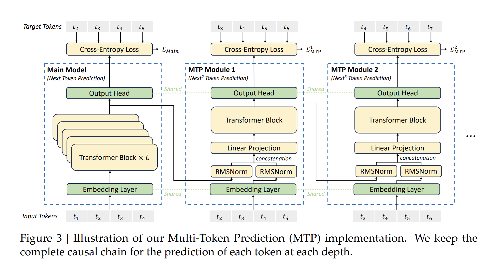

<!---
   Copyright (c) 2022-2026, NVIDIA CORPORATION. All rights reserved.
   NVIDIA CORPORATION and its licensors retain all intellectual property
   and proprietary rights in and to this software, related documentation
   and any modifications thereto. Any use, reproduction, disclosure or
   distribution of this software and related documentation without an express
   license agreement from NVIDIA CORPORATION is strictly prohibited.
-->

# Multi-Token Prediction (MTP)

Multi-Token Prediction (MTP) extends the prediction scope to several future tokens at each position. An MTP objective adds extra prediction targets, which can improve data efficiency. It may also encourage representations that anticipate later tokens. This implementation predicts additional tokens in sequence and preserves the causal dependency chain at each depth. The following figure illustrates MTP as used in [DeepSeek-V3](https://github.com/deepseek-ai/DeepSeek-V3/).



The *k*-th MTP module includes a shared embedding layer, a projection matrix, a Transformer block, and a shared output head. For the *i*-th input token at depth *k - 1*, the implementation combines the representation of the *i*-th token and the embedding of the *(i + K)*-th token with a linear projection. That combined representation is the input to the Transformer block at depth *k*, which produces the output representation.

For more detail, refer to the [DeepSeek-V3 technical report](https://arxiv.org/pdf/2412.19437.pdf).

## Related Arguments

Train `GPTModel`-style models with MTP by setting `mtp_num_layers` to a positive integer.

The following table summarizes MTP configuration fields:

| Item | Description |
| --- | --- |
| `mtp_num_layers` | Number of MTP layers. MTP extends prediction to multiple future tokens at each position. This stack uses `mtp_num_layers` sequential modules to predict that many additional tokens per position. Default: `None`. |
| `mtp_loss_scaling_factor` | Weight for the MTP loss term. The implementation averages MTP losses across depths, multiplies by this factor, and adds the result to the training objective. Default: `0.1`. |

## Pipeline Parallel Layout for MTP

MTP supports user-defined placement of MTP layers across pipeline stages through `pipeline_model_parallel_layout`. By default, all MTP layers sit on the last pipeline stage; you can override placement in the layout string.

### MTP Standalone Mode

When MTP layers are placed in a separate virtual pipeline (VPP) stage that is not on the last pipeline rank, the `mtp_standalone` flag is automatically set to `True`. MTP then runs in its own pipeline stage.

### Layout Format

Use `m` for MTP layers in the pipeline layout string. For example:
- `"E|t*3|(t|)*5mL"` - MTP in the last stage
- `"E|t*3|(t|)*4tm|L"` - MTP in the second-to-last stage with a decoder layer
- `"E|t*3|(t|)*3tt|m|L"` - MTP in a standalone stage (second-to-last) with no other layers

### Constraints

- Place all MTP layers in the same virtual pipeline stage.
- Do not place MTP layers on the first pipeline rank.

## Implementation Notes

- For models with MTP layers, the final LayerNorm sits in the stage that contains the last decoder layer, not in the post-process stage. That can change gradient norm reduction slightly in deterministic mode when LayerNorm would otherwise live in another stage. For bitwise alignment, disable gradient norm clipping.
- MTP loss is computed in the post-processing stage.

## Unsupported Combinations

Context Parallel (CP), arbitrary `AttnMaskType`, and learned absolute position embeddings are not supported with MTP.

## Knowledge distillation from the main model

MTP can learn from the main model's next-token distribution, aligned to each
MTP depth. The main model supplies a detached teacher through the shared output
projection; the student is the corresponding MTP head. The per-token objective is

```text
mtp_ce_loss_weight * CE(labels, student)
  + mtp_kl_loss_weight * T^2 * KL(softmax(teacher / T) || softmax(student / T))
```

Here `T` is `mtp_kd_logit_temperature`. The existing
`mtp_loss_scaling_factor / mtp_num_layers`, loss masks, and token normalization
apply to the combined objective. Weights must be finite and nonnegative; they
need not sum to one. Temperature must be finite and positive.

Defaults (`--mtp-ce-loss-weight 1 --mtp-kl-loss-weight 0`) preserve CE-only
training and avoid computing teacher logits. For KD-only training use:

```bash
--mtp-num-layers 2 \
--mtp-ce-loss-weight 0 \
--mtp-kl-loss-weight 1 \
--mtp-kd-logit-temperature 2
```

For a mixture, use e.g. `--mtp-ce-loss-weight 0.3 --mtp-kl-loss-weight 0.7`.
KL is training-only, matching the source implementation: evaluation computes
only the weighted CE component, and KD-only evaluation attaches no MTP loss.
Setting both weights to zero disables the MTP auxiliary loss.

Teacher projection is performed before sequence shifting, preserving sequence
parallelism. Teacher logits and their cached full-vocabulary normalizers are
shifted with packed document boundaries and the configured context-parallel
layout. Vocabulary-parallel KL uses global normalizers and reductions without
all-gathering vocabulary logits. The backward recomputes probabilities and never
backpropagates through the teacher. Student output-head gradients follow the
existing `mtp_detach_heads` setting. Early backward remains available; it still
retains teacher logits in addition to the current student's logits.

`mtp_N loss` reports the weighted CE + KL objective before overall MTP scaling,
including in KD-only training. `mtp_N ce_loss` reports unweighted CE when enabled;
`mtp_N kd_logit_loss` reports unweighted temperature-scaled KL when enabled.
The combined loss and CE metric retain upstream microbatch/rank mean averaging;
KL retains its token-count-weighted aggregation. With uneven token counts these
aggregations differ, so the logged combined loss need not equal a weighted sum
of the two logged component metrics.
Acceptance metrics remain available for KD-only training. KL logging divides
accumulated loss sums by accumulated counts; an empty microbatch contributes a
zero sum and a count of one, matching the source branch. The KL metric is not
scaled by the logging microbatch factor a second time.

The local sum-exp, KL, and gradient helpers use `torch.compile(dynamic=False)`
by default. Set `MTP_KD_DISABLE_COMPILE=1` before
starting Python to use eager PyTorch instead. Compilation adds first-use latency;
steady-state performance depends on the shapes and runtime. Distributed
collectives remain outside the compiled helpers.

