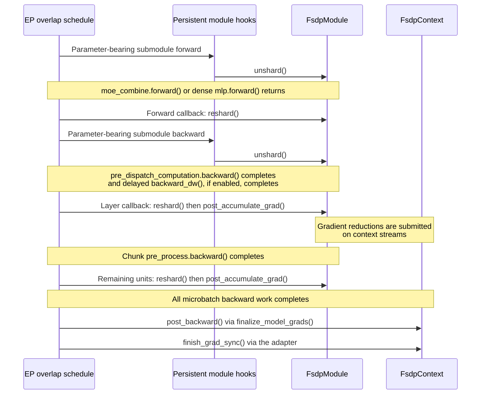

<!---
   Copyright (c) 2026, NVIDIA CORPORATION. All rights reserved.
   NVIDIA CORPORATION and its licensors retain all intellectual property
   and proprietary rights in and to this software, related documentation
   and any modifications thereto. Any use, reproduction, disclosure or
   distribution of this software and related documentation without an express
   license agreement from NVIDIA CORPORATION is strictly prohibited.
-->

# M-FSDP v2 integration with EP overlap

Combined 1F1B executes a layer through fine-grained schedule nodes. Some nodes
call submodules directly, bypassing the owning `FsdpModule.forward()` and its
ordinary execution hooks. The integration gathers parameters at the submodule
calls that consume them and lets the schedule choose when to release parameters
and submit completed gradients for reduction.

`FsdpModule` owns parameter materialization and gradient reduction.
`FsdpContext` owns communication streams and execution-order state. The EP
overlap schedule supplies the forward and backward completion boundaries.

## Persistent hooks and per-microbatch callbacks

| Registration | Lifetime | Responsibility |
| --- | --- | --- |
| `setup_mfsdp_v2_ep_overlap()` calls `register_fsdp_module_hooks()` after wrapping | Persistent hooks on the model | Gather an owning unit before a parameter-bearing submodule's forward or backward; release gathered parameters after evaluation forwards. |
| `TransformerModelChunkSchedulePlan.register_fsdp_hooks()` calls `register_fsdp_ep_overlap_schedule_hooks()` | Callbacks bound to one microbatch's schedule plan | Release layer parameters after forward, complete each unit at its last scheduled backward use, and complete remaining units at the chunk boundary. |

The adapter sets `SchedulePolicy.register_hooks=False` for EP overlap, so the
ordinary FSDP module hooks and parameter-gradient countdown do not also perform
these operations. The persistent integration hooks remain active across
microbatches; creating a plan binds callbacks to its nodes without registering
another set of module hooks. `release_state()` drops the completed plan's
references.

## Demand gathering

The persistent hooks walk the module tree while tracking the nearest enclosing
`FsdpModule`. A nested FSDP unit becomes the owner of its own parameters. Before
a parameter-bearing submodule runs forward or backward, its hook calls the
owner's `unshard()`.

Root-owned parameters also need stream preparation: their forward demand hook
orders all-gather after the current stream, and their backward demand hook calls
`FsdpContext.pre_backward()` before unsharding. This makes the reduction stream
participate in an active CUDA Graph capture.

Demand gathering makes weights available where the fine-grained schedule uses
them. Parameter release and gradient completion use the explicit boundaries
below because different schedule nodes can create separate autograd GraphTasks,
and delayed `backward_dw()` produces gradients after autograd returns.

## Completion boundaries

The following sequence follows one layer's local dependencies and then its
chunk's completion. Forward and backward work from adjacent microbatches can
interleave, and kernels on different streams can overlap.

`TransformerLayerSchedulePlan.set_fsdp_schedule_callbacks()` attaches the
forward callback to `moe_combine`, or `mlp` for a dense layer. It reshards that
layer module and its independently sharded descendants. For an MTP plan, the
forward callback receives `mtp_model_layer`.

The layer's backward callback belongs to `pre_dispatch_computation`, the first
forward node and last backward node. Without delayed wgrad it runs after that
node's `backward()`. With delayed wgrad it runs after `backward_dw()`, including
the first forward layer's wgrad deferred until after the layer loop. The
callback invokes `complete_fsdp_unit_backward()` for the units assigned to
that layer plan: `reshard()` releases gathered parameters and
`post_accumulate_grad()` packs gradients and submits their reductions.

`register_fsdp_ep_overlap_schedule_hooks()` discovers units from the outer
model chunk, including its wrappers. It assigns each unit once, visiting layer
plans in forward order. A unit repeated in several plans is assigned to its
first forward occurrence, which finishes last in backward. Units outside the
layer plans stay in a closure owned by the chunk plan. After
`pre_process.backward()` and the chunk's stream dependency, the chunk callback
completes those remaining units, including the root.

For supported untied MTP models, root-owned embedding and output-head
parameters can receive contributions from several nodes or depths. They remain
available until the chunk completion boundary. Tied embedding/output weights
are rejected with M-FSDP v2 EP overlap. Uses of layer-owned parameters outside
their assigned schedule boundary are outside this integration's contract.

## Schedule completion and gradient visibility

The MCore adapter uses `autograd_completes_execution=False` because one
schedule contains multiple autograd backward calls. After all microbatch
backward work, `finalize_model_grads()` calls `FsdpContext.post_backward()` once
for the shared context to finish execution-order tracking. That context-level
operation is distinct from completing an individual unit's gradients.

Unit completion submits the reductions allowed by the current gradient
finalization mode. `SKIP_OUTER` omits outer-DP reduction during accumulation;
the final microbatch must submit the required outer reductions. The adapter's
`finish_grad_sync()` then delegates to the context to order the current stream
after submitted inner- and outer-reduction work before gradients are consumed.
It enqueues GPU stream dependencies without blocking the CPU, and does not
launch reductions skipped earlier.

Evaluation uses the ordinary forward path without a combined training plan.
The persistent forward post-hook on each `FsdpModule` calls `reshard()` when
`module.training` is false, so evaluation releases gathered weights without
waiting for a training-plan callback.

## Implementation references

- [Hook registration and unit completion](../../../../models/common/combined_1f1b_mfsdp_scheduler.py)
- [Layer and chunk schedule callbacks](../../../../models/common/model_chunk_schedule_plan.py)
- [FSDP context lifecycle](../megatron_fsdp/experimental/context.py)
- [MCore gradient finalization](../../../finalize_model_grads.py)
