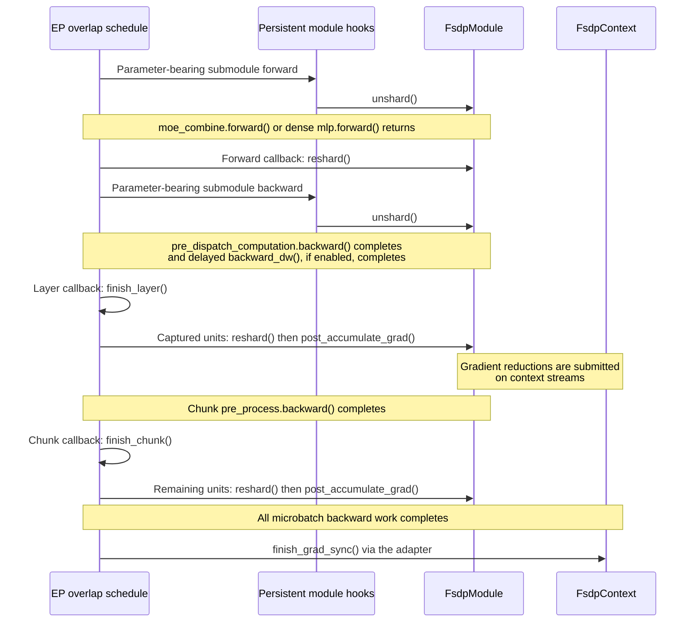

<!---
   Copyright (c) 2026, NVIDIA CORPORATION. All rights reserved.
   NVIDIA CORPORATION and its licensors retain all intellectual property
   and proprietary rights in and to this software, related documentation
   and any modifications thereto. Any use, reproduction, disclosure or
   distribution of this software and related documentation without an express
   license agreement from NVIDIA CORPORATION is strictly prohibited.
-->

# M-FSDP v2 integration with EP overlap

The EP overlap schedule (implemented by the combined 1F1B scheduler and enabled by `overlap_moe_expert_parallel_comm`) executes each layer as a sequence of fine-grained schedule nodes. Some of these nodes call submodules directly and therefore bypass the owning `FsdpModule.forward()` and its ordinary execution hooks. To compensate, the integration (1) gathers parameters on demand, at the submodule call that consumes them, and (2) lets the schedule decide when to release parameters and when to submit completed gradients for reduction.

`FsdpModule` owns parameter materialization and gradient reduction. `FsdpContext` owns the communication streams and execution-order state. The EP overlap schedule supplies the forward and backward completion boundaries.

## Persistent hooks and per-microbatch callbacks

| Registration | Lifetime | Responsibility |
| --- | --- | --- |
| `setup_mfsdp_v2_ep_overlap()` calls `register_fsdp_module_hooks()` after wrapping | Persistent hooks on the model | Gather an owning unit before a parameter-bearing submodule's forward or backward; release gathered parameters after evaluation forwards. |
| Schedule callbacks bound by `register_fsdp_hooks()` | One microbatch's schedule plan | Release layer parameters after forward; complete each unit at its last backward use; complete the remaining units at the chunk boundary. |

The adapter sets `SchedulePolicy.register_hooks=False` for EP overlap, so the ordinary FSDP module hooks and the per-unit gradient countdown do not duplicate these operations. The persistent hooks stay registered across microbatches, while schedule callbacks are bound per plan and dropped by `release_state()`.

Persistent hooks run when PyTorch invokes a submodule. Schedule callbacks run when an EP overlap schedule node reaches its completion boundary.

## Demand gathering

The persistent hooks walk the module tree while tracking the nearest enclosing
`FsdpModule`. A nested FSDP unit becomes the owner of its own parameters. Before
a parameter-bearing submodule runs forward or backward, its hook calls the
owner's `unshard()`.

Root-owned parameters need extra stream preparation. Their forward demand hook orders the all-gather after the current stream. Their backward demand hook calls `FsdpContext.pre_backward()` before unsharding, which makes the reduction stream wait on the current stream so that it is included when a CUDA Graph is being captured.


Demand gathering makes weights available where the fine-grained schedule uses
them. Parameter release and gradient completion use the explicit boundaries
below because different schedule nodes can create separate autograd GraphTasks,
and delayed `backward_dw()` produces gradients after autograd returns.

## Binding callbacks for one microbatch

After the schedule builds a chunk plan, it calls `register_fsdp_hooks(model)` with the outer MFSDP v2 model, and the plan then calls `register_fsdp_ep_overlap_schedule_hooks()`. Registration only binds callbacks:

1. Collect all FSDP units in the outer model chunk, including wrappers, into `remaining`.
2. Visit layer plans in forward order. Remove each plan's still-unassigned units from `remaining` and capture them in `finish_layer(_module, units=units)`. The default argument binds that plan's tuple now. Otherwise every closure would see the last loop iteration's `units`. Bind the callback through `plan.set_fsdp_schedule_callbacks()`.
3. Return `finish_chunk()` for the units left in `remaining`, including the root. The chunk plan stores it as `_on_backward_complete`. If no units remain, no chunk callback is created.

This assigns backward completion once per unit. If a shared unit A appears twice, forward order `A(first) -> B -> A(second)` becomes `A(second) -> B -> A(first)` in backward. The first plan's callback completes A once, after both backward uses. Each forward callback still reshards all units in its layer, including nested experts.

## Completion boundaries

The following sequence follows one layer's local dependencies and then its
chunk's completion. Forward and backward work from adjacent microbatches can
interleave, and kernels on different streams can overlap.



`TransformerLayerSchedulePlan.set_fsdp_schedule_callbacks()` attaches the
forward callback to `moe_combine`, or `mlp` for a dense layer. It reshards that
layer module and its independently sharded descendants. For an MTP plan, the
forward callback receives `mtp_model_layer`.

The layer's backward callback is attached to `pre_dispatch_computation`, which is the first forward node and the last backward node of a layer:

```text
pre_dispatch_computation.backward() / delayed backward_dw()
  -> node post-backward hook
  -> finish_layer()
  -> complete_fsdp_unit_backward(unit) for each captured unit
  -> unit.reshard() then unit.post_accumulate_grad()
```

Without delayed wgrad, `finish_layer()` runs after the node's `backward()`. With delayed wgrad, it runs after `backward_dw()`. For the first layer in forward order, delayed `backward_dw()` runs after the schedule's layer loop, so `finish_layer()` fires after that point. Unit completion releases gathered parameters, packs the gradients, and submits their reductions.

After `pre_process.backward()` and the chunk's stream dependency, the chunk plan invokes `_on_backward_complete`, which calls `finish_chunk()` to complete the remaining units. `release_state()` then drops the callback.

For supported untied MTP models, root-owned embedding and output-head
parameters can receive contributions from several nodes or depths. They remain
available until the chunk completion boundary. Tied embedding/output weights
are rejected with M-FSDP v2 EP overlap. Uses of layer-owned parameters outside
their assigned schedule boundary are outside this integration's contract.

## Schedule completion and gradient visibility

After all scheduled backward work finishes, including delayed weight gradients, MCore's `finalize_model_grads()` calls the adapter's `finish_grad_sync()`. Individual FSDP units have already submitted their completed gradients at the layer or chunk boundary.

Unit completion submits the reductions allowed by the current gradient-finalization mode. With `SKIP_OUTER`, outer-DP reduction is skipped during accumulation, so the final microbatch must submit it. The adapter's `finish_grad_sync()` then makes the current stream wait on all submitted inner and outer reductions before gradients are consumed. It only enqueues GPU stream dependencies, so it does not block the CPU, and it does not launch reductions that were skipped earlier.

Evaluation uses the ordinary forward path without a combined training plan. The persistent forward post-hook on each `FsdpModule` calls `reshard()` when `module.training` is false, so evaluation releases gathered weights without waiting for a training-plan callback.

## Implementation references

- [Hook registration and unit completion](../../../../models/common/combined_1f1b_mfsdp_scheduler.py)
- [Layer and chunk schedule callbacks](../../../../models/common/model_chunk_schedule_plan.py)
- [FSDP context lifecycle](../megatron_fsdp/experimental/context.py)
- [MCore gradient finalization](../../../finalize_model_grads.py)
