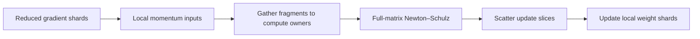

<!---
   Copyright (c) 2026, NVIDIA CORPORATION. All rights reserved.
-->

# Muon with MFSDP v2

MFSDP shards one **module** at a time. By default, parameters of the same
dtype owned by that module form one parameter group, which is all-gathered
and gradient-reduced together. Its storage is partitioned across ranks as
one buffer. Muon, however, orthogonalizes each logical matrix separately.
The design problem is to make the complete matrix input available for that
operation while preserving module-level sharding and communication.

The current `FsdpMuon` keeps the usual sharded storage, gathers each split
matrix's optimizer input to one compute owner, and scatters the resulting
update. The alternative explored in
[issue #6161](https://github.com/NVIDIA/Megatron-LM/issues/6161), based on
[MatrixFSDP](https://arxiv.org/abs/2607.05895), makes whole-matrix ownership
the persistent storage layout. This removes the need for optimizer-step
redistribution but requires efficient communication for uneven module
shards during forward and backward.

Keep gather/scatter as the baseline and evaluate TensorAtomic placement as
an alternative using end-to-end training time and peak memory. Both should
compute the same full-matrix Muon update.

## The module is the sharding unit

Calling `fully_shard(module, ...)` creates an FSDP unit. It owns the module's
parameters, including those in descendants, except parameters already
managed by nested FSDP units. The implementation groups these parameters by
`(effective_dtype, requires_grad)`, so frozen and trainable parameters are
separate even when their dtype matches.

Each `FsdpParameterGroup` has a shared logical layout and buffers for model
weights, main weights, and gradients. For ordinary floating-point groups,
public `Shard(0)` selects the internal `RowAtomic` layout: tensors are
packed into a buffer, then ranks receive contiguous, equally sized buffer
segments. Alignment preserves complete rows, but a matrix can cross a rank
boundary. Other matrices can be entirely local to one rank. See the
[MFSDP design](mfsdp_design.md),
[group construction](../megatron_fsdp/experimental/module.py), and
[layout builders](../megatron_fsdp/experimental/layout_builder.py).

For example, consider five trainable FP32 parameters owned by one module.
They share one group buffer, partitioned across five ranks as follows. This
layout is covered by
[`test_compute_layout_fills_lcm_padding_gaps`](../../../../../../tests/unit_tests/distributed/mfsdp_v2/test_dbuffer.py#L60)
and illustrated in
[`build_for_row_atomic`](../megatron_fsdp/experimental/layout_builder.py#L39).

```text
Shapes: P0=(2,6), P1=(4,4), P2=(4,4), P3=(1,2), P4=(1,6)
One group buffer, 12 elements per rank (including padding)

rank 0 [ 0,12): | P0 row 0              | P0 row 1               |
rank 1 [12,24): | P1 row 0      | P1 row 1      | P1 row 2       |
rank 2 [24,36): | P1 row 3      | P3    | gap   | P2 row 0       |
rank 3 [36,48): | P2 row 1      | P2 row 2      | P2 row 3       |
rank 4 [48,60): | P4                    | pad                    |
```

All-gather assembles these five segments into the full group buffer on
each rank for module computation. Backward reduces the group's full
gradient buffers together and scatters the corresponding 12-element
segments back to their ranks. Each shard contains complete rows, but only
`P0`, `P3`, and `P4` remain whole on one rank. `P1` spans ranks 1 and 2, and
`P2` spans ranks 2 and 3; these matrices need gathering before local
full-matrix Muon orthogonalization.

An FSDP parameter group defines storage and communication. It is distinct
from an optimizer's `param_groups`, which define settings such as learning
rate and weight decay. Choosing separate Muon and Adam parameter lists does
not, by itself, change FSDP grouping or storage placement.

### Comparison with PyTorch FSDP2

PyTorch FSDP2 normally shards **each parameter independently along dim 0**.
It also groups parameters by `fully_shard` calls for communication. Thus,
the difference is how each rank's shard is formed, not whether parameters
can share an all-gather or reduce-scatter. This comparison is specifically
with FSDP2; PyTorch FSDP1 uses flattened parameter groups.
[PyTorch FSDP2 documentation](https://docs.pytorch.org/docs/2.14/distributed.fsdp.fully_shard.html#communication-grouping-and-scheduling)

For example, consider one module containing three trainable matrices of
the same dtype: `A[8, 4]`, `B[12, 4]`, and `C[4, 4]`. The group contains
96 elements. On two ranks, a RowAtomic layout needs no padding:

```text
MFSDP group buffer, 48 elements per rank

rank 0: [ A: all 8 rows ][ B: rows 0–3 ]
rank 1: [ B: rows 4–11  ][ C: all 4 rows ]

FSDP2 per-parameter sharding

rank 0: [ A: rows 0–3 ][ B: rows 0–5  ][ C: rows 0–1 ]
rank 1: [ A: rows 4–7 ][ B: rows 6–11 ][ C: rows 2–3 ]
```

In the MFSDP layout, only `B` crosses a rank boundary. `A` and `C` already
have complete local inputs for Muon once their gradients are reduced.
Consequently, optimizer redistribution should depend on which matrices
cross buffer boundaries, rather than assume every matrix spans every rank.

## Why Muon needs a different optimizer path

Momentum accumulation and weight decay are elementwise and can run on
local shards. Newton–Schulz orthogonalization couples elements across the
logical matrix through matrix products and normalization. Independently
orthogonalizing its row shards generally produces a different update.
Orthogonalizing the module's concatenated buffer would also change the
algorithm: each original matrix remains a separate optimization domain.

The implementation must therefore establish whole-matrix inputs at the
orthogonalization boundary, or implement an equivalent distributed matrix
operation. The approaches here establish whole-matrix inputs on one rank.
Gradients must already be reduced across data-parallel ranks before this
stage; gathering shards assembles the input and does not perform that
reduction.

## Gather and scatter with the existing layout

The current implementation is
[`FsdpMuon`](../megatron_fsdp/experimental/muon.py). Parameters, gradients,
and momentum retain their sharded layout between steps. A **compute owner**
temporarily assembles each matrix's input and computes its update; it does
not become the permanent owner of the other ranks' parameter shards.

For each FSDP parameter group, the optimizer performs these steps:

1. Apply the configured weight decay and update momentum on local shards.
   Construct the local Newton–Schulz input, including Nesterov momentum
   when enabled.
2. Gather participating matrix fragments to their assigned compute owners.
   A matrix already local to its owner needs only a local copy.
3. Run Emerging Optimizers' Muon orthogonalization and scaling once per
   full matrix on its owner.
4. Scatter each update's remote slices back to the ranks that store the
   corresponding parameter shards. The owner uses its own slice directly.
5. Apply local updates and synchronize main weights into model weights.



[`gather_scatter.py`](../megatron_fsdp/experimental/gather_scatter.py) uses
batched point-to-point sends and receives. Only participating remote
fragments move; full matrices are not replicated onto all ranks.
[`assign_owner_work`](../megatron_fsdp/experimental/owner_planning.py)
balances estimated Newton–Schulz work across groups, while restricting each
matrix's owner to ranks that already hold a nonempty fragment. Matrices
with only one eligible owner contribute fixed work to that plan.

In the example above, choosing rank 1 as `B`'s compute owner sends its first
four rows from rank 0 to rank 1, then sends the corresponding update rows
back. `A` and `C` require no optimizer-step network traffic. More generally,
for a matrix of `N` elements whose owner already holds `n` elements, gather
and scatter each transfer `N - n` elements across the network in aggregate.
Their byte counts depend on the input and update dtypes. This accounting
excludes the ordinary forward/backward communication.

The main benefit is preserving balanced persistent buffer shards and the
existing module communication path. The costs are redistribution after
backward, temporary full matrices, and limited freedom to balance compute
owners. The current optimizer processes groups sequentially on the caller's
CUDA stream. Scratch includes local group buffers and the full matrices
assigned to this rank in the current group; it is not limited to one full
matrix. Pipelining groups or overlapping local orthogonalization with
communication is a future scheduling optimization.

Current scope is 2D parameters on a shared one-dimensional DP mesh, with
non-quantized main weights and gradients and no tensor parallelism.
Non-2D parameters are skipped; callers must route them, and excluded
matrices such as embeddings, to a separate optimizer.

### Replicated gathering as a baseline

[Issue #5533](https://github.com/NVIDIA/Megatron-LM/issues/5533) also describes
gathering boundary-matrix momentum onto multiple ranks and running
orthogonalization redundantly. That is a useful simple baseline, but it
adds replicated full-matrix storage and computation. The current
gather/scatter path implements the single-compute-owner alternative using
P2P communication. The issue's all-to-all-v terminology describes the
redistribution pattern; it does not imply that the current code invokes an
all-to-all-v collective.

## TensorAtomic placement based on MatrixFSDP

MatrixFSDP assigns each complete matrix to one persistent owner, with empty
shards on other ranks. Backward delivers the reduced gradient to that
owner, where momentum, orthogonalization, and the weight update run
locally. Forward and backward still materialize full module weights and
release those temporary copies afterward. Its communication-free claim
applies to the matrix optimizer step. The paper also packs non-matrix
parameters into owner roles for AdamW.
[MatrixFSDP, Sections 3 and 4](https://arxiv.org/html/2607.05895v1)

### Mapping the idea to MFSDP

MFSDP already has
[`TensorAtomic`](../megatron_fsdp/experimental/placement.py) and a layout
builder that packs complete tensors into owner segments without padding.
For the fully sharded variant, use matching TensorAtomic placements for
parameters, gradients, and optimizer buffers. Supply construction-time
owners through `fully_shard_context(parameter_to_owner=...)`. Every
parameter in a TensorAtomic group needs an owner, including parameters
handled by another optimizer.

The resulting lifecycle is:

```text
Persistent whole matrices on owners
    → materialize the module's weights for forward/backward
    → reduce gradients to the same owners
    → update momentum and run full-matrix Muon locally
    → update owner weights for the next materialization
```

This changes placement within the module's parameter group; it does not
require creating one FSDP unit per matrix. Different groups may use
different strategies. Within one group, the current layout construction
does not allow mixing TensorAtomic with RowAtomic or BlockAtomic buffer
placements. Selecting a different optimizer for some tensors does not
override that restriction.

### Uneven communication is central

Whole matrices rarely divide evenly across ranks within a single module.
A rank can own several matrices while another owns none. Balancing bytes
over the entire model cannot guarantee balanced contributions to every
module's communication. Padding all ranks to the largest owner segment
would undermine the expected savings. The MatrixFSDP authors emphasize
this distinction in
[the issue discussion](https://github.com/NVIDIA/Megatron-LM/issues/6161#issuecomment-5229334204).

MFSDP's current
[`DBuffer`](../megatron_fsdp/experimental/dbuffer.py) already selects
list-based `all_gather` and `reduce_scatter` for uneven segments; its NCCL
path uses grouped broadcasts and reduces. This is distinct from both the
equal-sized tensor collectives used for RowAtomic buffers and the
optimizer's fragment gather/scatter. An owner-aware P2P backend is another
implementation to evaluate within the same module schedule.

For a group with `P` elements on `D` ranks and largest owner segment
`O_max`, padding would allocate or transmit `D * O_max` elements instead
of `P`. Avoiding padding removes that waste, but a large owner may still
limit communication and compute throughput. The planner must account for
both model-wide resident memory and work within each module. Each matrix,
its optimizer state, and orthogonalization workspace must fit on its owner.

### Existing support and remaining work

TensorAtomic layout and uneven forward/backward communication exist. A
preliminary experiment in
[issue #6161](https://github.com/NVIDIA/Megatron-LM/issues/6161#issuecomment-6187168400)
reported similar forward/backward time to RowAtomic on one H800 node, but
excluded the optimizer step and used BF16 main weights. It does not
establish an end-to-end Muon advantage or multi-node behavior.

The proposed optimizer extension is an explicit local path that bypasses
gather/scatter, as described in
[the follow-up](https://github.com/NVIDIA/Megatron-LM/issues/6161#issuecomment-6370533084).
The existing generic helpers would have no remote fragments to exchange
for whole-owner tensors, but still construct scratch buffers and local
copies. The direct path should consume local momentum inputs and update
owner weights without those staging operations. It also needs end-to-end
validation with the companion optimizer for excluded parameters.

## Choosing between the approaches

| Consideration | Current gather/scatter | TensorAtomic alternative |
| --- | --- | --- |
| Persistent placement | Equal-sized group buffer shards, subject to alignment padding | Complete tensors packed into potentially uneven owner segments |
| Optimizer communication | Remote fragments of split matrices move to and from compute owners | None for the matrix update when weights, gradients, and momentum share owners |
| Forward/backward | Existing equal-sized group collectives | Uneven group materialization and reduction |
| Memory pressure | Sharded state plus temporary full matrices on compute owners | Whole-matrix state and workspace must fit on persistent owners |
| Load balancing | Compute owners restricted to existing fragment holders | Storage owners can be planned across groups, subject to per-module imbalance |
| Main tradeoff | Pay optimizer redistribution while retaining the default layout | Remove redistribution while changing storage balance and module communication |

The comparison must measure how much optimizer traffic is actually left
under module-level sharding. A workload with few split matrices may gain
little from removing that traffic. A workload dominated by boundary-matrix
redistribution may benefit more, provided the TensorAtomic owners fit in
memory and uneven communication performs well.

For evaluation, hold module boundaries, Muon settings, precision, and
companion-optimizer routing fixed. Compare reduced gradients, momentum,
updates, and loss trajectories against full-matrix Muon, including uneven
and empty local shards and distinct data on each DP rank. Measure maximum
rank time for the full training step and its phases, peak allocated memory,
bytes transferred, and owner workload imbalance on single-node and
multi-node configurations. A faster optimizer step is useful only if it
improves the complete training step within the memory budget.
